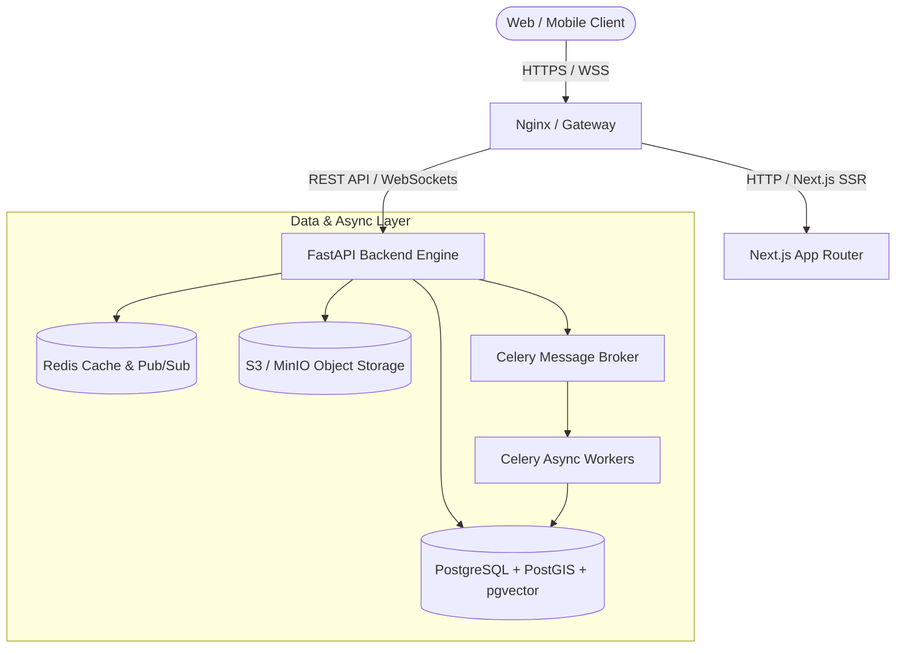

# 🏠 Flatmate Platform Monorepo

[](https://github.com/flatmate/flatmate-platform)
[](https://fastapi.tiangolo.com)
[](https://nextjs.org)
[-336791.svg?logo=postgresql)](https://www.postgresql.org)
[](LICENSE)

An intelligent, full-stack flatmate matching and co-living rental platform built with **Next.js 14**, **FastAPI**, **PostgreSQL** (with **PostGIS** geospatial queries and **pgvector** lifestyle compatibility scoring), **Redis**, and **Celery**.

---

## 🌟 Highlights

- **🧠 Multi-Factor Lifestyle Matching Engine**: Combines pgvector cosine similarity with weighted category scoring (sleep schedule, cleanliness, social battery, habits, diet, and pet tolerance).
- **📍 Geospatial Discovery**: PostGIS-powered radius searches, commute-time calculations, and interactive map interfaces.
- **👥 Flatmate Groups ("Team-Up to Rent")**: Form hunting syndicates with compatible seekers to search and apply for entire properties together.
- **⚡ Real-Time Messaging & Presence**: Asynchronous WebSockets powered by Redis Pub/Sub for direct and group chat, typing indicators, and read receipts.
- **🛡️ Identity & Trust Verification**: Multi-tier verification pipeline (Govt ID, employment/student status, background checks, and community reviews).
- **📋 End-to-End Rental Applications**: Structured application tracking from draft submission to landlord review, interview scheduling, and digital lease proposals.

---

## 🏗️ Architecture Overview



---

## 📁 Repository Structure

```
flatmate-platform/
│
├── apps/
│   ├── web/                     # Next.js 14 application (App Router, Tailwind CSS, Lucide)
│   │   ├── app/                 # Routes: properties, flatmates, matches, chat, dashboard
│   │   ├── components/          # Shared atomic and feature UI components
│   │   ├── features/            # Feature-driven slices and workflows
│   │   ├── hooks/               # Custom React hooks (useAuth, useSocket, useMatches)
│   │   ├── lib/                 # API client, utilities, and constants
│   │   └── public/              # Static assets and media
│   │
│   └── api/                     # Python FastAPI backend
│       ├── app/
│       │   ├── main.py          # Application entrypoint & middleware configuration
│       │   ├── core/            # Config, Async SQLAlchemy, JWT Security, Lifecycle
│       │   ├── api/             # API v1 routes aggregation
│       │   ├── modules/         # Modular Domain Driven Design (Auth, Matching, Properties, etc.)
│       │   ├── infrastructure/  # Storage (MinIO), Cache (Redis), Geo (PostGIS)
│       │   └── workers/         # Celery tasks (score recalculations, notifications)
│       ├── migrations/          # Alembic database migrations
│       ├── tests/               # Pytest integration & unit test suite
│       ├── pyproject.toml       # Python dependencies and build metadata
│       └── Dockerfile           # Optimized production container
│
├── packages/
│   ├── contracts/               # Shared TypeScript DTOs and API contract definitions
│   ├── ui/                      # Reusable UI component library (Buttons, Badges, Modals)
│   └── config/                  # Shared ESLint, Prettier, and TypeScript configurations
│
├── database/
│   ├── migrations/              # Raw SQL migration scripts (PostGIS, pgvector, schemas)
│   ├── seeds/                   # Production-like mock datasets (users, listings, preferences)
│   └── policies/                # PostgreSQL Row-Level Security (RLS) rules
│
├── infrastructure/
│   ├── docker/                  # Dedicated Dockerfiles and Nginx reverse proxy configs
│   └── deployment/              # Kubernetes manifests & Helm charts
│
├── docs/                        # Engineering & Product Documentation
│   ├── PRD.md                   # Product Requirements Document
│   ├── SYSTEM_DESIGN.md         # Architecture, C4 diagrams, and event flows
│   ├── DATABASE_DESIGN.md       # Entity-Relationship diagrams and indexing specs
│   ├── API_DESIGN.md            # REST and WebSocket specifications
│   ├── SECURITY.md              # Auth, privacy, RLS policies, and trust models
│   └── DEVELOPMENT_GUIDE.md     # Local setup, testing, and contribution protocols
│
├── scripts/                     # Automation utilities (setup, seed, lint, codegen)
├── .github/workflows/           # CI/CD pipelines (test, lint, container build)
├── .env.example                 # Environment variable templates
├── docker-compose.yml           # Multi-container local orchestration
└── README.md
```

---

## 🚀 Quick Start (Docker)

The fastest way to spin up the entire platform (PostgreSQL + PostGIS + pgvector, Redis, MinIO, FastAPI, and Next.js) is via Docker Compose:

```bash
# 1. Clone repository
git clone https://github.com/flatmate/flatmate-platform.git
cd flatmate-platform

# 2. Copy environment template
cp .env.example .env

# 3. Start all containers
docker compose up -d

# 4. View logs
docker compose logs -f
```

- **Frontend Application**: [http://localhost:3000](http://localhost:3000)
- **FastAPI OpenAPI Interactive Docs**: [http://localhost:8000/docs](http://localhost:8000/docs)
- **MinIO Storage Console**: [http://localhost:9001](http://localhost:9001) (`minioadmin` / `minioadmin`)

---

## 💻 Local Development Setup

### Prerequisites
- Node.js >= 20.x
- pnpm >= 9.x
- Python >= 3.11
- Docker & Docker Compose

### 1. Install Dependencies
```bash
# Install frontend and shared package dependencies
pnpm install

# Setup Python virtual environment
cd apps/api
python -m venv .venv
source .venv/bin/activate  # On Windows: .venv\Scripts\Activate.ps1
pip install -e .
cd ../..
```

### 2. Run Database & Cache
```bash
docker compose up -d postgres redis minio
```

### 3. Run Migrations & Seeds
```bash
# Run database migrations
./scripts/seed_db.sh
# Or on Windows PowerShell:
.\scripts\seed_db.ps1
```

### 4. Run Development Servers
```bash
# From the root directory:
pnpm dev
```

---

## 🧪 Testing & Quality Assurance

```bash
# Run backend tests
cd apps/api
pytest

# Run frontend tests & linting
pnpm test
pnpm lint
```

---

## 📜 Documentation

Detailed specifications and architectural decisions are documented under `/docs`:
- [Product Requirements Document (PRD)](docs/PRD.md)
- [System Architecture & Design](docs/SYSTEM_DESIGN.md)
- [Database Schema & Indexes](docs/DATABASE_DESIGN.md)
- [API & WebSocket Specifications](docs/API_DESIGN.md)
- [Security, RLS & Verification Standards](docs/SECURITY.md)
- [Developer Onboarding Guide](docs/DEVELOPMENT_GUIDE.md)

---

## 📄 License
This project is licensed under the MIT License - see the LICENSE file for details.
