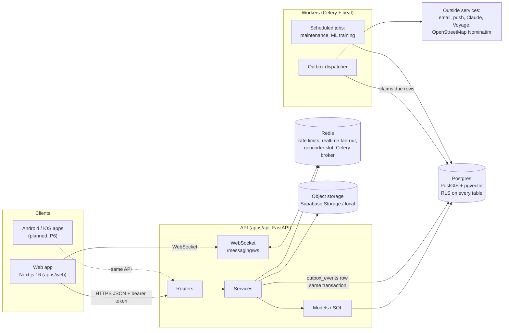

# Flatmate architecture

How the system is put together, what each layer is for, how a request moves through it, and
the rules each layer keeps. New code (and the Android and iOS apps) should follow this. When the
code and this document disagree, the code is right and this document needs fixing.

Written 2026-11-25 from the code at that date. Older design docs are listed at the end with what
in them is out of date.

---

## 1. The system at a glance

- **One API, many clients.** The web app and the mobile apps use the same HTTP API. No client
  talks to the database or to Supabase's data API: Supabase's `anon` and `authenticated` roles
  have every table privilege revoked (migration 005).
- **A modular monolith.** One FastAPI process, split into domain modules (`app/modules/*`). It
  scales by running more identical instances. Anything shared between instances lives in
  Postgres or Redis, never in process memory (rate limits, realtime fan-out, geocoder
  throttling).
- **Slow or outside work happens later, in workers.** A request writes its change and an
  `outbox_events` row in one transaction. The worker sends emails and push notifications,
  calls Claude, geocodes and refreshes embeddings afterwards, with retries.

## 2. Repository map

| Path | What lives there |
|---|---|
| `apps/web` | Next.js 16 (React 19) web app. |
| `apps/web/app` | Routes (App Router). Server components fetch public data for search engines and a fast first paint. |
| `apps/web/features/<domain>` | Domain UI: components, hooks and models for listings, messaging, matching, owner tools, admin and so on. |
| `apps/web/components` | Shared app components (navbar, cards, report dialog, empty and error states). |
| `apps/web/hooks` | React hooks: `useAuth`, `useApiQuery`, `useSocket`, `useNearMe` and others. |
| `apps/web/lib` | Plain TypeScript rules with no React (query building, chat state, auth store, socket hub), unit-tested in `apps/web/tests`. |
| `apps/web/next.config.mjs` | Security headers and the CSP (built by `lib/csp.mjs`). There is no request proxy (`proxy.ts`): the web app has no per-request server logic, and it doesn't use Supabase Auth. |
| `packages/contracts` | `openapi/v1.json`: the API contract, generated from the code and checked in CI (§7.1). `src/`: TypeScript types for requests and responses, written by hand to match it, and shared constants (e.g. `LISTING_QUICK_QUESTIONS`). |
| `packages/ui` | Design-system components (`Button`, `Modal`, `Card`, ...). |
| `apps/api/app/main.py` | App wiring: middleware, the error handler, health checks, `/api/v1` routes. |
| `apps/api/app/api/v1/router.py` | Mounts every module router. |
| `apps/api/app/modules/<domain>` | `router.py` (HTTP), `service.py` (rules), `models.py` (tables), `schemas.py` (request and response shapes), plus domain helpers. |
| `apps/api/app/core` | Config, database engine, auth tokens and dependencies, errors, middleware, rate limiting, logging and observability. |
| `apps/api/app/infrastructure` | Adapters to outside systems: storage, email, SMS, image processing, virus scanning, cache, geospatial helpers. |
| `apps/api/app/workers` | Outbox dispatcher, Celery app and beat schedule, maintenance (retention) jobs. |
| `apps/api/app/ml` | Rankers, embeddings and semantic search, moderation, smart replies, the Claude client, training and evaluation. |
| `apps/api/migrations` | Alembic migrations (currently up to `019_device_push_tokens`). |
| `database/migrations/complete_hosted_schema.sql` | The whole schema as one SQL file for the hosted database (generated from Alembic, see §4.6). |
| `.github/workflows` | CI, security scans, image builds, staging and production deploys, backups, hosted migrations, uptime checks. |

## 3. Who uses it: roles

| Role | Can | Enforced in |
|---|---|---|
| Seeker (default) | Search, save, ask owners, apply, book visits, match with flatmates, join groups. | Signed-in routes (`get_current_user`). |
| Owner, PG operator, broker | List and manage properties, rooms and beds; answer chats; confirm visits; review applications. | `require_roles([...])` on owner routes, plus ownership checks in services (e.g. `prop.owner_id == user.id`). |
| Moderator | Moderation queue and the applications panel. | `STAFF_ROLES` in `app/core/dependencies.py`. |
| Admin, super admin | Everything: stats, user management, listing approval, payment events. | `require_roles(["admin", "super_admin"])`. |

Roles live in the database (`user_roles`) and are copied into the access token. **The web app
only uses roles for display**, taking them from `/auth/me` and never from storage
(`lib/auth-store.ts`, `lib/staff-access.ts`). Every check that matters happens in the API.

## 4. The layers and the rules each one keeps

### 4.1 Web (`apps/web`)

**Its job:** draw the product, keep the user's place, and turn user actions into API calls.
It holds no business rules that the API doesn't also enforce.

- **Fetching data.**
  - Public pages (listing search and detail, sitemap, metadata) are fetched on the server
    through `lib/server-api.ts`, so the HTML has the content.
  - On the client the page continues with `useApiQuery`, seeded with the server's data
    (`initial`). Pass `variant` when the answer depends on who is asking, e.g. the
    personalised "Recommended" order.
  - Everything else goes through `lib/api-client.ts`, which handles the bearer token, a
    refresh when a 401 comes back, timeouts and RFC 7807 errors.
- **Auth.** Tokens are in `localStorage`. `useAuth()` reads one shared store. Only a 401/403
  from the API signs a user out; a network error doesn't.
- **Realtime.** One WebSocket per tab (`lib/socket-hub.ts`), shared by chat, the notification
  bell and the notifications page.
- **Where code goes.**
  - Rules that can be tested without a browser go in `lib/` as pure functions with tests in
    `apps/web/tests` (`npm test` runs `tsc` and `node --test`).
  - Components stay thin.
  - Code that runs in node tests imports contract *values* from their file, not from the
    `@flatmate/contracts` barrel (see `lib/ask-owner.ts`).
- **Rules.**
  - Never read or write the database or Supabase data directly.
  - Never trust anything in storage for permissions.
  - Never put personal data in URLs (Near me puts only `near=1` in the URL and keeps the
    position in memory).
  - Show the API's own error messages; they are written for users.
  - Respect hydration: the first client render must match the server's.

### 4.2 API routers (`app/modules/*/router.py`)

**Their job:** HTTP and nothing else. A router does four things:

1. Declares the path, method, status code and response model.
2. Authenticates with `get_current_user`, `get_optional_user` (public pages that show more
   to some viewers) or `require_roles([...])`.
3. Validates input through Pydantic schemas. Use `Literal` for enumerations, so unknown values
   are a 422 rather than a silent pass-through. Example: `CreateConversationRequest.type`
   accepts only the chat kinds the API can check.
4. Applies per-route rate limits (`RateLimiter` dependency).

Then it calls a service.

- **Rules.**
  - No business rules and no multi-step SQL in routers.
  - Set caching headers on purpose: `private, no-store` for anything personal (for example
    `GET /locations/nearest`).
  - New endpoints go under `/api/v1`. A breaking change needs a new version (see P6).

### 4.3 Services (`app/modules/*/service.py`)

**Their job:** the business rules, each in one place, whichever client or route triggers it.

- **Authorise the specific thing, not just the route.** Is this your listing? Are you in this
  conversation? Is the listing live? Is this person blocked, or not accepting direct messages?
- **Own the transaction.**
  - Write the change and any `outbox_events` row, then commit once.
  - After the commit, do the best-effort extras: realtime broadcasts and immediate dispatch.
    Example: `MessagingService.send_message`.
- **Raise the typed exceptions** from `app/core/exceptions.py` (`NotFoundException`,
  `ForbiddenException`, `BadRequestException`, `ConflictException`, `RateLimitException`).
  They become RFC 7807 `application/problem+json` responses with a stable `error_code` and
  the request id.
- **Rules.**
  - Something that happens *because of* a change (an email, a push, a geocode, an embedding
    refresh, an AI moderation pass) is an outbox event, never an inline network call.
  - A follow-up step must not undo the main action if it fails. Confirming a visit stays
    confirmed even if unlocking the chat fails; that failure is logged.
  - When a rule protects people, enforce it on every path, not just the one the web app
    uses. The listing-chat validation in `create_conversation` exists because the generic
    endpoint could otherwise sidestep `POST /messaging/listing-chats`.

### 4.4 Models (`app/modules/*/models.py`)

**Their job:** the tables, with types, constraints and indexes.

- **Timestamps** are `DateTime(timezone=True)` with `default=utcnow` / `onupdate=utcnow`
  (`app/core/database.py`). Never use `datetime.utcnow`: asyncpg sends a naive datetime as the
  machine's local time, which stored timestamps 5h30 early on India-time machines.
- **Constraints go in the model as well as the migration.** On a fresh database, migration
  001 creates tables from the current models, so a later migration's `CREATE TABLE IF NOT
  EXISTS` is skipped. Add constraints in a conditional `DO` block (see `018_listing_ranking`).
- **Location** is a PostGIS `geography` with a GiST index. Listings expose an approximate,
  fuzzed position to everyone except the owner.

### 4.5 Database and security

- **Engine.** Postgres with PostGIS and pgvector; Supabase in production.
- **Row-level security** is enabled on every table, and Supabase's `anon` / `authenticated`
  roles have no table privileges (migrations 005 and 007), so the browser cannot reach data
  through Supabase's REST API even with the anon key.
- **The API logs in as a least-privilege role** (`flatmate_app`, no `BYPASSRLS`). CI checks
  that this login can't run DDL.
- **Connections.** Through Supabase's transaction pooler (port 6543) the engine turns off
  asyncpg's prepared-statement cache (`engine_options`).
- **Backups and restores** have their own workflow (`db-backup.yml`) and runbook
  (`docs/PHASE_19_BACKUP_RESTORE_REPORT.md`).

### 4.6 Migrations (`apps/api/migrations`)

- **Writing them.**
  - One SQL statement per `op.execute` (asyncpg runs one statement per call).
  - Make them safe to re-run: `IF NOT EXISTS`, and conditional `DO` blocks for constraints.
  - Always write a `downgrade`.
- **The hosted schema file.** After adding migration N:
  1. Generate its SQL with `alembic upgrade <N-1>:<N> --sql`.
  2. Splice the block (from `-- Running upgrade` to its `UPDATE alembic_version`) into
     `database/migrations/complete_hosted_schema.sql`, after the previous block.
  3. Check the block on a throwaway database migrated to N-1.

  The hosted database is migrated by `hosted-db-migration.yml`.

### 4.7 Core (`app/core`)

| File | Job |
|---|---|
| `config.py` | Every setting, from the environment. Features that need an outside service switch off cleanly when its key is missing (`ANTHROPIC_API_KEY`, `EMBEDDING_PROVIDER`, `GEOCODER`, `SENTRY_DSN`). |
| `security.py` | Access tokens (60 min) and refresh tokens (30 days), signed JWTs carrying the user id and roles. |
| `dependencies.py` | `get_current_user` (an access token for an existing, active account), `get_optional_user`, `require_roles`, `STAFF_ROLES`. |
| `exceptions.py` | Typed errors returned as RFC 7807 problem documents. |
| `middleware.py` | Request id (`X-Request-ID`), cloud trace id, timing, request body size limits, security headers. |
| `rate_limit.py` | Sliding-window limits in Redis, shared by all instances, falling back to per-process. Signed-in callers are keyed by user, anonymous ones by IP (trusting only `TRUSTED_PROXY_HOPS` proxies). `hit()` is for custom keys (per email, per seeker per day). |
| `logging.py`, `observability.py` | JSON log lines with request ids, and Sentry when configured. Logs carry paths, not query strings, and no message text or personal data. |

Health checks: `/health/live` (process up) and `/health/ready` (database and Redis reachable).

### 4.8 Infrastructure (`app/infrastructure`)

Adapters behind small interfaces, so the rest of the code doesn't care which provider is used:

- **Storage:** Supabase Storage or a local disk. Private files are served only through
  short-lived signed URLs.
- **Email:** a provider in production, a memory outbox in tests. Every email has an
  idempotency key.
- **Also here:** SMS, image processing, virus scanning, cache and geospatial helpers.

New outside services get an adapter here and a setting in `config.py` that turns them off.

### 4.9 Workers (`app/workers`)

- **The outbox** (`outbox.py`).
  - **Claiming:** due rows are claimed with `FOR UPDATE SKIP LOCKED` and a 5-minute lease.
    Handlers run outside any transaction.
  - **Success:** the row is marked published and its payload scrubbed (reset links and
    message text are removed).
  - **Failure:** exponential backoff; after 8 attempts the row becomes a dead letter.
  - **Delivery is at least once,** so every handler must be idempotent.
  - **Event types:** `email.send`, `message.created` (the unread-message email after a
    delay), `push.send`, `embedding.refresh`, `message.moderate`, `property.moderate`,
    `listing.geocode`.
- **Celery beat** (`celery_app.py`):
  - outbox dispatch every 15 s;
  - maintenance hourly (`maintenance.py`: retention purges such as listing interactions
    after 180 days, expired tokens, old dead letters);
  - the flatmate ranker on Mondays at 03:30 UTC;
  - the listing ranker on Mondays at 04:00 UTC.
- **Rules.**
  - Handlers use the session factory they're given, never the API's pooled
    `AsyncSessionLocal`, because Celery tasks run in their own event loop.
  - New event types go in `HANDLERS`, with a test that runs them through `dispatch_pending`.
  - Tests must delete the outbox rows they create, including `embedding.refresh` (keyed by
    `entity_id`) and `email.send` (keyed by `to`). Leftovers crowd other tests out of the
    50-row batch.

### 4.10 ML and AI (`app/ml`)

The same pattern every time: **explainable first, learned only when it proves itself, and
nothing depends on an outside model being up.**

| Piece | What it does | Safety rails |
|---|---|---|
| Flatmate compatibility (`modules/matching/engine.py`) | 10 explainable factors, shown to users as a breakdown. | Always available. |
| Flatmate ranker (`ranker.py`) | Logistic regression on like/pass decisions. | Activates only if it beats the compatibility score on held-out AUC (time-based split). |
| Listing "Recommended" (`listing_ranking.py`) | 24 explainable features with a weighted score and up to 2 reasons per card. | Same AUC gate for the learned version. Duplicates and reported listings sink. Opt-out in Privacy. Interactions kept 180 days. |
| Semantic search (`embeddings.py`, `search.py`, `indexing.py`) | Voyage embeddings, or a local hashing embedder with no key. | Vectors are tagged with their model, so different models' vectors are never compared. |
| Moderation (`moderation.py`, `moderation_jobs.py`) | Instant rule-based checks, then a Claude verdict in the worker. | Nothing is auto-deleted. Users see warnings, and confirmed cases go to human review. |
| Smart replies (`smart_replies.py`) | Up to 3 suggestions, on request. | Template fallback. Contact details are removed from the context. |
| Claude client (`llm.py`) | Structured outputs, low effort, server-side fallbacks. | Every failure becomes `LLMUnavailable` and each caller has a non-AI path. Only the text being judged is sent, never names, emails, phone numbers or ids. |

### 4.11 Realtime chat

- **Connecting.** `GET /api/v1/messaging/ws`, authenticated by the first frame (an access
  token). The socket closes when the token expires or the account is disabled.
- **Fan-out.** Events go through Redis pub/sub (`broker.py`), so a message sent to one
  instance reaches sockets on all of them; without Redis it falls back to in-memory.
- **Sending.** Messages can be sent over the socket or REST. Both go through
  `MessagingService.send_message`, so the same rate limit, block checks and moderation apply.
- **Contact details in listing chats** stay hidden until the owner confirms a visit
  (`contact_guard.py`). They are hidden when messages are read, never when stored. **Any new
  path that returns message text must apply `hide_contacts`.**

## 5. How a request flows

### 5.1 A write: a seeker asks an owner a question

1. **Web.** The listing page's "Ask the owner" sheet composes the message from the quick
   questions and calls `POST /api/v1/messaging/listing-chats` through `apiClient`. The bearer
   token is attached and refreshed once on a 401.
2. **Middleware.** It assigns a request id, checks the body size and sets the security
   headers.
3. **Router.**
   - `get_current_user` loads an active account from the token.
   - `RateLimiter` allows 30 requests per hour per user.
   - Pydantic validates `{property_id, content}`.
4. **Service** (`MessagingService.start_listing_chat`):
   - the listing must be live and its owner active;
   - the person can't be its owner;
   - it reuses an existing chat about this listing, or rate-limits new chats (20 a day) and
     creates one (checking blocks);
   - it then sends the first message: scam pre-screen, the message row and an outbox row,
     committed together.
5. **After the commit:**
   - a realtime `message.created` goes to both people, with contact details hidden;
   - an in-app notification is created (without the message text);
   - if the text looked risky, an AI moderation job is queued.
6. **Response:** `{conversation_id, created, message_id}`. The web app opens the chat.
7. **Later, in the worker.** The `message.created` outbox row becomes due after the
   unread-email delay. If the owner still hasn't read it, they get one email, throttled, with
   no message text.

### 5.2 A read: the browse page

1. **Server.** `/properties` runs on the server and calls `GET /api/v1/properties?sort=recommended&...`
   anonymously. The HTML includes the first page of results.
2. **Client.** It hydrates with that data. If the person is signed in, `useApiQuery`'s
   `variant` makes it refetch with their token, so they get their own order.
3. **API.** The listing service filters with SQL (PostGIS distance when "Near me" is on, or
   text search). It ranks up to 300 candidates (`rank_listings`), returns the page with
   reasons, and records impressions for signed-in people who haven't opted out.

## 6. Checklist for new code

- [ ] **Placement:** HTTP concerns in the router, rules in the service, tables in models,
      pure web logic in `lib/` with a test.
- [ ] **Authorisation:** the service checks who may do this to *this* object, not just that
      someone is signed in.
- [ ] **Enumerations** are `Literal` or validated, so unknown values are rejected rather than
      ignored.
- [ ] **Side effects** (email, push, AI, geocoding) go through the outbox; handlers are
      idempotent.
- [ ] **Privacy:**
  - no personal data in URLs, logs or AI prompts;
  - new personal tables are added to `EXPORT_TABLES` and `PURGE_DELETE`
    (`users/privacy.py`), with a retention job if they grow without limit;
  - new message-text paths apply `hide_contacts`.
- [ ] **Abuse:** a rate limit on anything that creates content or contacts other people.
- [ ] **Time:** timezone-aware datetimes only; daily limits reset at India midnight
      (`start_of_today_utc`).
- [ ] **Outside services** switch off cleanly without their key, and the feature still works.
- [ ] **Schema changes:** an Alembic migration (one statement per `op.execute`, re-runnable,
      with a downgrade), the model updated, and the block spliced into the hosted SQL file.
- [ ] **Contracts:** the OpenAPI snapshot is re-exported (`python -m app.core.api_contract
      export`) with no unintended breaking changes, and `packages/contracts/src` matches.
- [ ] **Tests:**
  - database tests run against the local test database (never a hosted one) and clean up
    what they create, including outbox rows;
  - web rules have node tests;
  - user-facing changes are checked in a browser.

## 7. For the mobile apps

Everything the apps need is in the API. The rules above already apply to them, because the
server enforces them, not the web app.

### 7.1 The contract

- **What to build against.** `packages/contracts/openapi/v1.json` is the API's OpenAPI
  document, committed. Generate the Kotlin and Swift API clients from it (e.g. OpenAPI
  Generator). A React Native app can use the TypeScript types in `packages/contracts/src`
  instead.
- **Keeping it current.** The pytest suite fails when the code and the snapshot differ. To
  update it, run `python -m app.core.api_contract export` in `apps/api`. Export with the
  pinned versions (`apps/api/constraints.txt`): other FastAPI/Pydantic versions word the
  document differently, so export refuses without them.
- **Pinned dependencies.** `apps/api/constraints.txt` holds the exact versions CI tested. CI,
  every workflow and the Docker images install with it, so production runs what was tested.
- **Keeping it stable.** CI compares the snapshot with the previous commit's
  (`app/core/api_contract.py` lists what counts as breaking) and fails on changes that would
  break an installed app:
  - removed endpoints or response fields;
  - new required inputs;
  - narrowed types;
  - new response enum values.

  Prefer additive changes: a new optional field, or a new endpoint next to the old one. When
  a break is intended, list it in `packages/contracts/openapi/accepted-breaking-changes.txt`
  with the reason. A redesign goes under `/api/v2` while `/api/v1` keeps serving the
  installed apps.
- **Errors** are RFC 7807 problem documents. Branch on `error_code`, never on the wording.

### 7.2 Calls the apps make

- **On every request,** send `X-Client-Platform: android|ios` and `X-Client-Version: 1.4.0`.
- **On start and after any 426,** call `GET /api/v1/meta/app-config`. When the app is below
  `min_version`, every API call answers **426** with `error_code: CLIENT_UPGRADE_REQUIRED`
  and `update_url`; show an update screen. `latest_version` is for an optional "update
  available" hint.
- **How to retire an old app version:**
  1. ship the app version that copes with the change;
  2. wait for most people to update;
  3. raise `MIN_APP_VERSION_<PLATFORM>`;
  4. make the API change.
- **Sign-in** is the same as the web: `POST /auth/login` gives access and refresh tokens. Keep
  them in the Keystore/Keychain, and refresh on 401 with `POST /auth/refresh`.
- **Realtime** uses the WebSocket protocol in §4.11. Reconnect with a fresh access token on
  close code 4001, and stop on 4003.

### 7.3 Push notifications

- **Registering.** After sign-in and on every start, call `POST
  /api/v1/notifications/push/devices` with `{platform, token, app_version}`. It is
  idempotent; a token moves to whoever registered it last. Before signing out, call `POST
  /api/v1/notifications/push/devices/unregister`.
- **Delivery.** The `push.send` worker delivers each notification to the account's browsers
  (Web Push) and apps. Android goes through FCM HTTP v1 and iOS through APNs (HTTP/2, a .p8
  key); see `app/modules/notifications/native_push.py`. Each platform switches on when its
  settings are present (`.env.example`).
- **What a push contains.** `title`, `body`, and data `{url, id, category}`. `url` is a path
  on this site: open the matching screen. On Android, `category` is the notification channel
  (`messages`, `matches`, `rentals`, `account`), which the app must create. Message pushes
  never contain the message text.
- **Settings.** People's push settings (`/notifications/preferences`) apply to the apps too.
  Message pushes are skipped while the person is connected to the socket.

### 7.4 Deep links

- **What the apps open.** Links to the product screens open in the apps; sign-in, password
  reset, admin and legal pages stay on the web. The list is `APP_LINK_PATHS` in
  `apps/web/lib/deep-links.ts`; the Android intent filters should match it.
- **Proving the apps belong to the site.** The website serves `/.well-known/assetlinks.json`
  (Android App Links) and `/.well-known/apple-app-site-association` (iOS Universal Links and
  password autofill). They come from `ANDROID_APP_PACKAGE`, `ANDROID_APP_SHA256_FINGERPRINTS`
  and `IOS_APP_IDS`, and answer 404 until those are set.

### 7.5 Until the apps ship

The website is installable (a PWA):
- a manifest with PNG and maskable icons, an iPhone Home Screen icon, and shortcuts;
- a service worker for every visitor that shows `/offline.html` when there's no network
  (it caches nothing else);
- Web Push, which on iPhone works from the Home Screen app.

## 8. Older documents and what is out of date

| Document | Still useful for | Out of date |
|---|---|---|
| `ARCHITECTURAL_DECISIONS.md` | Why a modular monolith, PostGIS/pgvector, the explainable compatibility algorithm. | ADR 008 says Next.js 14; the app is on Next.js 16 with React 19. |
| `API_DESIGN.md` | The endpoint list by module, RFC 7807 errors. | Its "success envelope" (`{success, data, meta}`) isn't what the API returns: successes are the resource as plain JSON (only a handful of older action endpoints return `{"success": true}`). |
| `DATABASE_DESIGN.md` | The original entity model. | It predates migrations 006-018 (outbox dispatch, least-privilege role, locations, listing precision, listing interactions). The migrations are the source of truth. |
| `DATA_PRIVACY.md` | Principles and data-subject rights. | Check new retention rules (e.g. 180-day listing interactions) in `users/privacy.py` and `workers/maintenance.py`. |
| `LAUNCH_GAP_LIST.md` | What was done for launch and why, item by item. | (Current.) |
