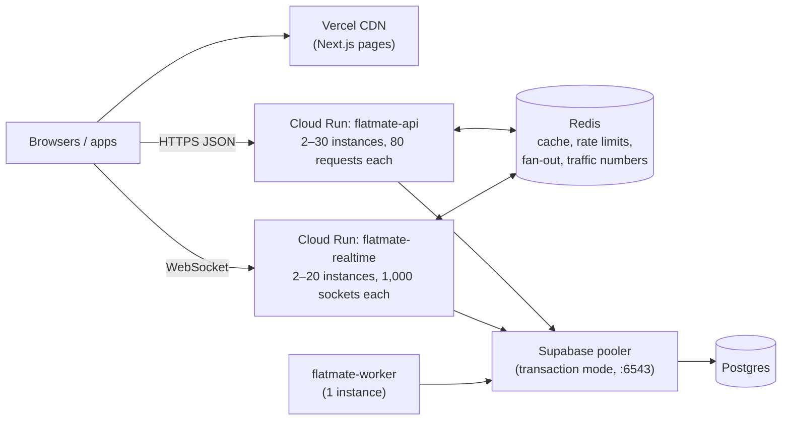

# Capacity plan: 10,000 people at once

How Flatmate serves 10,000 simultaneous users without errors or crashes, what was measured,
and what production needs. Last measured 2026-11-25.

## 1. The target in numbers

- **People at once:** 10,000, signed in or browsing.
- **Request rate:** people read a page for 3–10 s between actions, so 10,000 people make about
  **1,500 API requests a second**. A launch spike is planned at 2× that, about 3,000 a second.
- **Live connections:** every signed-in browser tab holds one WebSocket (chat and the
  notification bell). Planned for up to **10,000 open sockets**.
- **Targets:**
  - fewer than 1% of requests fail;
  - the slowest 5% (p95) take under 800 ms;
  - a crowd past capacity gets a quick "busy, retry" and never crashes the service.

## 2. The design



1. **Stateless API instances that scale out.** Each holds nothing another instance needs:
   - sessions are signed tokens;
   - rate limits, realtime fan-out, presence and the traffic numbers live in Redis;
   - data lives in Postgres.

   Cloud Run adds instances as concurrency and CPU rise, up to `API_MAX_INSTANCES`.
2. **Sockets on their own service.** Idle sockets are cheap, but on Cloud Run each one takes a
   request slot. On the API they would push out ordinary requests. `flatmate-realtime` runs the
   same image with 1,000 sockets an instance and a one-hour timeout (clients reconnect with
   jitter after it). Events reach it through Redis whichever instance produced them.
3. **Caching the busiest reads** (`app/core/hot_cache.py`). Each process keeps a bounded
   in-memory copy, shared through Redis when it's connected. Concurrent misses for the same key
   load once, so an expiring entry under load doesn't send a burst of identical queries.

   | What | For how long | Why it's safe |
   |---|---|---|
   | City and state catalogue (every search with a city reads it) | 5 min | changes only with a migration |
   | Anonymous listing pages, including the browse page's default order | 20 s | the same for every visitor; signed-in rankings and "near me" are never cached |
   | An owner's reply-time badge (a 90-day aggregate on every listing view) | 10 min | a badge doesn't need to be to-the-second |
   | `/locations/*` responses at the CDN and in browsers | `Cache-Control` 1 h | as above |

4. **Overload protection: busy, not broken** (`app/core/overload.py`):
   - **Load shedding.** Past `MAX_IN_FLIGHT_REQUESTS` (100) requests in one process, new ones
     get `503` + `Retry-After` at once (`SERVER_BUSY`), instead of queueing until everyone
     times out.
   - **Deadline.** A request still running after `REQUEST_TIMEOUT_SECONDS` (30 s) is stopped
     with `504`, so a stuck call can't hold its slot and database connection. Uploads are
     exempt.
   - **Database busy is not a bug.** An exhausted pool (waits at most `DB_POOL_TIMEOUT_SECONDS`,
     10 s), "too many connections", a statement timeout (15 s on the API's login) or a database
     restart answers `503` + `Retry-After` (`SERVICE_BUSY`), not `500`.
   - **Health checks are never refused,** so Cloud Run doesn't restart a busy-but-healthy
     instance and make things worse.
   - **The web app retries quietly** (`apps/web/lib/api-client.ts`): up to 2 retries after
     `Retry-After` with jitter. `SERVER_BUSY` is retried for any method, since the request never
     ran. `SERVICE_BUSY` is retried only for reads, since a write may have got partway.
5. **No blocking work on the event loop.**
   - **Password hashing** (bcrypt, about 250 ms of CPU) runs in worker threads, 4 at a time.
     On the event loop, a burst of sign-ins would stall every request on the instance.
   - **Supabase key downloads** are a blocking call. An unknown key id now refetches at most
     once a minute, so tokens with invented key ids can't trigger it on every request.
6. **Fewer per-socket queries.** Each socket re-checks its account every 5 minutes (was 60 s:
   about 170 queries a second at 10,000 sockets, now about 33). Disabling an account still
   closes its sockets at once through a broadcast; the re-check is only the fallback.
7. **Process settings** (`apps/api/Dockerfile`):
   - one uvicorn process per vCPU (`WEB_CONCURRENCY`, set by the deploy);
   - keep-alive 75 s, longer than clients' think time, so connections are reused instead of
     reset;
   - 8 s graceful shutdown inside Cloud Run's 10 s;
   - startup CPU boost.

## 3. What was measured

`loadtests/` (README there). The runs below used:
- **API:** one process, uvicorn on Windows. That's without uvloop or httptools, so it's slower
  than the Linux container.
- **Same laptop (8 cores):** local Postgres and the Locust load generator.
- **Data:** 2,000 members, 300 owners and 3,000 listings in 36 cities.
- **Mix:** visitors, signed-in members and real sign-ins, 3–10 s apart.

So these numbers are **per process and pessimistic**.

| Run | Users | Requests/s | Failed | p50 | p95 | What it shows |
|---|---|---|---|---|---|---|
| Steady load | 700 | 109 | **0%** | 18 ms | 260 ms | One process comfortably serves ~100 requests a second |
| Past capacity | 1,000 | 140 | 2.2%, **all quick 503s** | 790 ms | 2.0 s | It sheds the excess instead of failing; no 500s |
| Spike, 4× capacity | 3,000 at 200/s | 447 | 68% turned away (p50 62 ms) | 62 ms | 2.7 s | **No crash, no 500s**; back to normal speed (list 7.5 ms) the moment it ended |
| Sockets | 2,000 | — | 0 dropped | pong 1.7 ms | pong 2.6 ms | 2× the realtime service's per-instance limit |
| Sockets | 5,000 | — | 5 of 5,000 failed to open, 0 dropped | pong 1.5 ms | pong 8 ms | Plenty of headroom per instance |

**Single requests:** an uncached city page takes about 8 ms of server time, a listing page or
the unread count about 4 ms.

**Before the fixes,** a busy pool hung for 30 s and then returned `500`, there was no limit
on queued work, and the per-socket re-check ran every minute.

**Under the spike,** a few health checks (4 of 94) timed out while the laptop's TCP accept
queue overflowed. On Cloud Run the front end holds connections, and each instance never gets
more than its concurrency.

## 4. Production sizing for 10,000 at once

| Piece | Setting | Why |
|---|---|---|
| **API** (`flatmate-api`) | 1 vCPU, 1 GiB, concurrency 80, **min 2, max 30**, timeout 60 s | 1,500 requests/s at ~100 per instance is 15–16 instances; 30 covers the 2× spike. Two stay warm, so the first users never wait for a cold start. |
| **Realtime** (`flatmate-realtime`) | 1 vCPU, 2 GiB, concurrency 1,000, **min 2, max 20**, timeout 3,600 s, CPU always on | 10,000 sockets is 10 instances; 20 leaves room for reconnect storms after a deploy. |
| **Worker** | 1 instance, as today | Emails, push and moderation run from the outbox at their own pace. |
| **Database pool per process** | API 10 + 5 overflow, realtime 5 + 5 | Measured: one API process never needed more than 15. |
| **Pooler clients** | 30 × 15 + 20 × 10 + worker ≈ **665** | The Supabase transaction pooler (port 6543) must accept that many clients. |
| **Supabase compute** | **Large** at minimum (800 pooler clients, 160 connections, 2 dedicated cores, ~$110/month). **XL** for launch week (1,000 clients, 4 dedicated cores, ~$210/month). | The current Free/Nano plan allows 200 pooler clients and 60 connections, about a tenth of this. |
| **Redis** | Memorystore Basic 1 GB, or a managed Redis with TLS in the same region | Required in production (the deploy fails without it). Holds the shared cache, rate limits, realtime fan-out and the fleet's traffic numbers. |
| **Web** | Vercel (scales by itself) | Point `NEXT_PUBLIC_WS_URL` at the realtime service: `wss://<realtime-url>/api/v1/messaging/ws`. |

These are the production workflow's defaults. Change them with GitHub variables, no code edit
needed:
- `API_MIN_INSTANCES`, `API_MAX_INSTANCES`, `API_CONCURRENCY`, `API_CPU`, `API_MEMORY`;
- `REALTIME_SERVICE`, `REALTIME_MIN_INSTANCES`, `REALTIME_MAX_INSTANCES`.

Before raising `API_MAX_INSTANCES`, check that instances × 15 still fits the pooler.

Supabase limits are from its compute table
(https://supabase.com/docs/guides/platform/compute-and-disk). Check them again before buying.

## 5. Watching traffic

- **Admin console → Traffic tab**, live and refreshed every 10 s. It shows:
  - requests per second, error rate, p50/p95/p99;
  - requests turned away (busy, database busy, timed out), requests in progress;
  - open sockets, database connections in use, event-loop delay;
  - the busiest routes, and each instance.

  The numbers are summed over every instance through Redis, and cover the last minute.
  Health is shown in plain words (healthy, under strain, failing, with the reasons). It's
  backed by `GET /api/v1/admin/traffic`, which needs an admin.
- **`GET /metrics`** for Prometheus or Grafana: per-route counters and latency histograms,
  in-flight requests, sockets, the database pool and event-loop delay. It exists only when
  `METRICS_TOKEN` is set, and it needs that token.
- **Cloud Monitoring** (`infrastructure/monitoring/`): a dashboard and four alert policies.
  - **Error rate** above 2% (critical).
  - **p95** above 1.5 s (warning).
  - **503s** above 1 a second (critical).
  - **Instances** at 80% of the max (warning).

  Apply them once the GCP project exists:

  ```
  gcloud monitoring dashboards create --config-from-file=infrastructure/monitoring/dashboard.json
  for f in infrastructure/monitoring/policies/*.json; do
    gcloud alpha monitoring policies create --policy-from-file="$f"
  done
  ```

  Then add a notification channel (email or SMS) to each policy.
- **Already in place:** the uptime workflow (`.github/workflows/uptime.yml`), Sentry for
  errors, and JSON request logs with durations in Cloud Logging.

## 6. When an alert fires

1. **Open the Traffic tab.**
   - Mostly "busy" and the instance count at its max: raise `API_MAX_INSTANCES`, but only if
     the database has headroom.
   - Mostly "database busy", or database connections near the limit: the database is the
     bottleneck. Upgrade the compute and the pooler before adding instances, because more
     instances only add more waiting clients.
   - High event-loop delay on every instance: CPU-bound. Add instances, or raise `API_CPU` to
     2 (two processes per instance).
2. **Started right after a deploy?** Roll back with the command in the deploy summary.
3. **One route slow?** Its p95 is in the busiest-routes table. Check that route's query plan.

## 7. Before launch: the 10,000-user rehearsal

The runs above prove the behaviour on one process. The full-size run must happen on
**staging, sized like production**. Only then do the database, pooler, Redis and Cloud Run
scaling work together under real load.

1. **Seed staging:**

   ```
   python loadtests/seed_load.py --allow-host <staging-db-host> --members 10000 --listings 5000
   ```

   It runs with staging's `SECRET_KEY`.
2. **Run Locust distributed.** One master and 4–8 workers on separate machines, since each
   worker gives about 1,500 users:

   ```
   locust -f loadtests/locustfile.py --host https://<staging-api> --headless -u 10000 -r 50 -t 30m --csv results/launch
   ```
3. **At the same time, run the sockets:**

   ```
   python loadtests/sockets.py --url wss://<staging-realtime>/api/v1/messaging/ws --sockets 10000 --ramp 100 --hold 1200
   ```
4. **Pass when:**
   - failures are under 1% and p95 is under 800 ms;
   - no 500s in the logs;
   - the Traffic tab stays "Healthy" or "Under strain", never "Failing";
   - database connections stay under 80% of the pooler limit.
5. **Clean up:** `python loadtests/seed_load.py --allow-host <host> --cleanup`.
