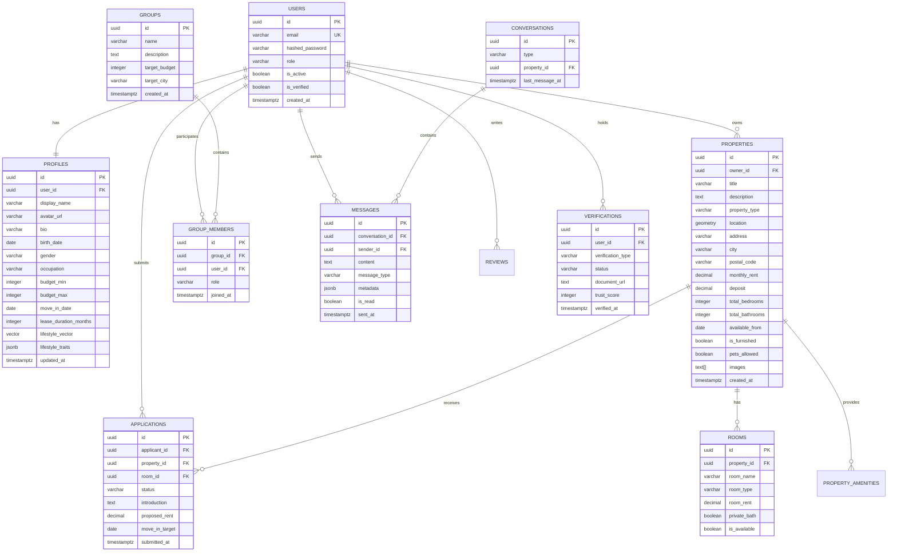

# Database Design & Schema Specification

**Database Engine:** PostgreSQL 16  
**Extensions Required:**
- `uuid-ossp`: Native UUID generation
- `postgis`: Geospatial coordinate queries and spatial indexing
- `vector`: High-performance vector similarity search (pgvector)
- `pg_trgm`: Trigram indexing for fuzzy text searches (names, cities, streets)

---

## 1. Entity-Relationship Diagram (ERD)



---

## 2. Table Specifications

### 2.1 `users`
Core user identity and authentication credentials.
| Column | Type | Constraints | Description |
| :--- | :--- | :--- | :--- |
| `id` | `UUID` | `PRIMARY KEY DEFAULT uuid_generate_v4()` | Unique user identifier |
| `email` | `VARCHAR(255)` | `UNIQUE, NOT NULL` | Verified login email |
| `hashed_password`| `VARCHAR(255)` | `NOT NULL` | Bcrypt hashed password |
| `phone_number` | `VARCHAR(32)` | `NULL` | Optional verified phone number |
| `role` | `VARCHAR(32)` | `NOT NULL DEFAULT 'seeker'` | `seeker`, `owner`, `admin` |
| `is_active` | `BOOLEAN` | `NOT NULL DEFAULT true` | Account active flag |
| `is_verified` | `BOOLEAN` | `NOT NULL DEFAULT false` | Platform verification badge |
| `created_at` | `TIMESTAMPTZ` | `NOT NULL DEFAULT NOW()` | Account creation timestamp |
| `updated_at` | `TIMESTAMPTZ` | `NOT NULL DEFAULT NOW()` | Last update timestamp |

### 2.2 `profiles`
Extended seeker/host profile, bio, and lifestyle vector embedding.
| Column | Type | Constraints | Description |
| :--- | :--- | :--- | :--- |
| `id` | `UUID` | `PRIMARY KEY DEFAULT uuid_generate_v4()` | Unique profile identifier |
| `user_id` | `UUID` | `UNIQUE, REFERENCES users(id) ON DELETE CASCADE` | Associated user account |
| `display_name` | `VARCHAR(100)` | `NOT NULL` | Public name |
| `avatar_url` | `TEXT` | `NULL` | S3 photo URL |
| `bio` | `TEXT` | `NULL` | Personal introduction |
| `birth_date` | `DATE` | `NULL` | Date of birth for age calculations |
| `gender` | `VARCHAR(32)` | `NULL` | `male`, `female`, `non_binary`, `other` |
| `occupation` | `VARCHAR(100)` | `NULL` | Student / Job title |
| `budget_min` | `INTEGER` | `NOT NULL DEFAULT 500` | Minimum monthly budget (\$) |
| `budget_max` | `INTEGER` | `NOT NULL DEFAULT 2000` | Maximum monthly budget (\$) |
| `move_in_date` | `DATE` | `NULL` | Target move-in date |
| `lifestyle_vector`| `VECTOR(64)` | `NOT NULL` | 64-dim normalized preference vector |
| `lifestyle_traits`| `JSONB` | `NOT NULL DEFAULT '{}'::jsonb` | Cleanliness, sleep, smoking, pets, diet |
| `preferred_locations`| `TEXT[]` | `NOT NULL DEFAULT '{}'` | Preferred neighborhoods/cities |
| `updated_at` | `TIMESTAMPTZ` | `NOT NULL DEFAULT NOW()` | Timestamp of last quiz update |

### 2.3 `properties`
Rental listings with PostGIS spatial coordinates.
| Column | Type | Constraints | Description |
| :--- | :--- | :--- | :--- |
| `id` | `UUID` | `PRIMARY KEY DEFAULT uuid_generate_v4()` | Listing identifier |
| `owner_id` | `UUID` | `REFERENCES users(id) ON DELETE CASCADE` | Property manager / Host |
| `title` | `VARCHAR(255)` | `NOT NULL` | Listing headline |
| `description` | `TEXT` | `NOT NULL` | In-depth description |
| `property_type`| `VARCHAR(50)` | `NOT NULL` | `apartment`, `house`, `condo`, `studio` |
| `location` | `GEOMETRY(Point, 4326)` | `NOT NULL` | WGS84 Longitude / Latitude point |
| `address` | `VARCHAR(255)` | `NOT NULL` | Street address |
| `city` | `VARCHAR(100)` | `NOT NULL` | City name |
| `state` | `VARCHAR(100)` | `NULL` | State / Province |
| `postal_code` | `VARCHAR(20)` | `NOT NULL` | Zip / Postal code |
| `monthly_rent` | `DECIMAL(10, 2)`| `NOT NULL` | Base rent amount |
| `deposit` | `DECIMAL(10, 2)`| `NOT NULL DEFAULT 0.00` | Security deposit |
| `total_bedrooms`| `INTEGER` | `NOT NULL DEFAULT 1` | Total bedroom count |
| `total_bathrooms`|`INTEGER` | `NOT NULL DEFAULT 1` | Total bathroom count |
| `available_from`| `DATE` | `NOT NULL` | Date listing becomes available |
| `is_furnished` | `BOOLEAN` | `NOT NULL DEFAULT false` | Furnished unit flag |
| `pets_allowed` | `BOOLEAN` | `NOT NULL DEFAULT false` | Pet friendly flag |
| `images` | `TEXT[]` | `NOT NULL DEFAULT '{}'` | Ordered array of photo URLs |
| `created_at` | `TIMESTAMPTZ` | `NOT NULL DEFAULT NOW()` | Creation timestamp |

### 2.4 `rooms`
Sub-units or individual rooms within a shared property.
| Column | Type | Constraints | Description |
| :--- | :--- | :--- | :--- |
| `id` | `UUID` | `PRIMARY KEY DEFAULT uuid_generate_v4()` | Room ID |
| `property_id` | `UUID` | `REFERENCES properties(id) ON DELETE CASCADE`| Parent property |
| `room_name` | `VARCHAR(100)` | `NOT NULL` | e.g. "Master Bedroom with En-suite" |
| `room_type` | `VARCHAR(50)` | `NOT NULL` | `private`, `shared` |
| `room_rent` | `DECIMAL(10, 2)`| `NOT NULL` | Specific room rent |
| `private_bath` | `BOOLEAN` | `NOT NULL DEFAULT false` | Attached private bathroom |
| `is_available` | `BOOLEAN` | `NOT NULL DEFAULT true` | Active availability |

### 2.5 `applications`
Structured rental tenancy applications submitted by seekers.
| Column | Type | Constraints | Description |
| :--- | :--- | :--- | :--- |
| `id` | `UUID` | `PRIMARY KEY DEFAULT uuid_generate_v4()` | Application ID |
| `applicant_id` | `UUID` | `REFERENCES users(id) ON DELETE CASCADE` | Submitting seeker |
| `property_id` | `UUID` | `REFERENCES properties(id) ON DELETE CASCADE`| Target property |
| `room_id` | `UUID` | `REFERENCES rooms(id) ON DELETE SET NULL` | Target room (if specific) |
| `status` | `VARCHAR(32)` | `NOT NULL DEFAULT 'submitted'` | `draft`, `submitted`, `reviewing`, `accepted`, `rejected` |
| `introduction` | `TEXT` | `NOT NULL` | Applicant message to landlord |
| `proposed_rent`| `DECIMAL(10, 2)`| `NOT NULL` | Offer amount |
| `move_in_target`| `DATE` | `NOT NULL` | Intended move-in date |
| `submitted_at` | `TIMESTAMPTZ` | `NOT NULL DEFAULT NOW()` | Submission timestamp |

### 2.6 `conversations` & `messages`
Real-time messaging entities.
- `conversations`: ID, type (`direct`, `group`), property_id (optional contextual link), created_at, updated_at.
- `messages`: ID, conversation_id, sender_id, content, message_type (`text`, `property_share`, `application_status`), metadata (`JSONB`), is_read, sent_at.

---

## 3. Indexing Strategy

```sql
-- 1. Spatial GIST Index for Ultra-Fast Radius and Polygon Searches
CREATE INDEX idx_properties_location ON properties USING GIST (location);

-- 2. HNSW Index on pgvector for Cosine Similarity Searches
CREATE INDEX idx_profiles_lifestyle_vector ON profiles 
USING hnsw (lifestyle_vector vector_cosine_ops)
WITH (m = 16, ef_construction = 64);

-- 3. Composite Filters & Common Lookups
CREATE INDEX idx_properties_city_rent ON properties (city, monthly_rent);
CREATE INDEX idx_properties_available_from ON properties (available_from);
CREATE INDEX idx_messages_conv_sent ON messages (conversation_id, sent_at DESC);
CREATE INDEX idx_applications_applicant ON applications (applicant_id, status);
CREATE INDEX idx_applications_property ON applications (property_id, status);
```
