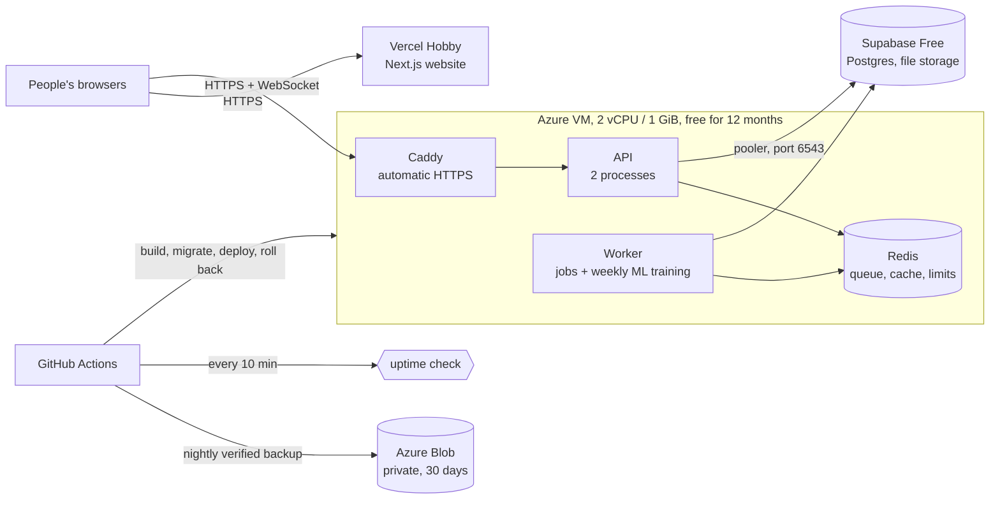

# Launching Flatmate for ₹0 (student plan)

This is the complete procedure for running Flatmate in production with no money and no credit
card, using free student offers. Every step is here, in order. The steps that need you (making
accounts, proving you're a student, accepting terms, choosing passwords) are marked
**You**; everything else is automated by scripts and GitHub Actions in this repository.

Read section 1 first: it says honestly what this setup can and can't do.

## 1. What you get, and the honest limits



| Part | Service and plan | Cost | Free for |
|---|---|---|---|
| API, worker, Redis, HTTPS | Azure for Students: B2ats v2 VM, 64 GB SSD | ₹0 (12-month free VM; the $100 credit covers the public IP) | 12 months, renewable yearly while a student |
| Database, file storage | Supabase Free | ₹0 | Always (paused after 7 days with no traffic; the uptime check prevents that) |
| Website | Vercel Hobby | ₹0 | Always (non-commercial use only, see below) |
| Images (Docker) | GitHub Container Registry | ₹0 | Always for a public repository |
| CI/CD, uptime checks | GitHub Actions | ₹0 | Always for a public repository |
| Backups | Azure Blob (private) | ₹0 (5 GB free) | 12 months |
| Email | Brevo Free (300 emails a day) | ₹0 | Always |
| Error tracking | Sentry (Student Pack) | ₹0 | 1 year, renewable |
| Domain (optional) | Name.com, .TECH or Namecheap .me (Student Pack) | ₹0 | 1 year (then about ₹800–1,500 a year) |
| Search and matching AI | Built in (local embeddings, ranking models trained weekly) | ₹0 | Always |

**What it can carry.** The code is the same as the 10,000-user design (docs/CAPACITY_PLAN.md):
overload gets a quick "busy, retry" answer instead of a crash, and the web app retries for you.
The hardware is not, though:
- **The VM's stack was measured with 600 people at once** (section 15): no errors, the slowest
  5% of requests within 21 ms, using about 660 MiB of its 1 GiB.
- **Supabase Free** (shared CPU, 500 MB RAM, 500 MB data) will run out first. Plan on a few
  hundred to about a thousand people at once, then upgrade it.

10,000 people at once needs the paid plan in docs/CAPACITY_PLAN.md: no free plan anywhere can
do that.

**What's turned off, and why:**

| Off | Why | Turn it on when |
|---|---|---|
| Phone verification by SMS | Twilio costs money. The app hides it (`SMS_PROVIDER=disabled`). | You can pay for SMS (Twilio, with DLT registration for India). |
| Paid plans | Live Razorpay needs a registered business. Everything is free for users meanwhile. | You have a business and KYC; see E6 in LAUNCH_GAP_LIST.md. |
| AI moderation and smart replies (Claude) | They need a paid Anthropic key. Rule-based moderation still runs. | Set `PRODUCTION_ANTHROPIC_API_KEY`. |
| Virus scanning of uploads (ClamAV) | It needs about 1 GB more RAM than the VM has. Uploads are still checked for type and size. | You move to a bigger server (E8). |

**Two rules to keep:**
- **Vercel Hobby is for non-commercial projects.** When you start charging, move to Vercel Pro
  or another host.
- **Free offers expire:**
  - the Azure free VM after 12 months;
  - the domain after 1 year;
  - the backup link after 1 year.

  Section 13 lists the dates to write down.

## 2. Accounts (You)

Use one email for everything if you can. Turn on two-factor sign-in on every account; section 12
says why.

1. **GitHub Student Developer Pack:** <https://education.github.com/pack>, "Sign up for Student
   Developer Pack".
   - Verify with your college email, or upload your student ID card when asked.
   - Approval can take a few days.
   - It gives you GitHub Pro, the Azure offer, Sentry's student plan, a free domain and more.
2. **Azure for Students:** <https://azure.microsoft.com/free/students>, "Start free".
   - Sign in with a Microsoft account and verify with your college email (or through the GitHub
     pack).
   - **No credit card.**
   - It has a spending limit: when the $100 credit is used up, things stop. Nothing is ever
     billed to you.
3. **Supabase:** you already have the project. Keep it on the Free plan.
4. **Vercel:** <https://vercel.com/signup>, "Continue with GitHub", Hobby plan.
5. **Brevo** (email): <https://www.brevo.com>, free plan, no card.
6. **Sentry** (optional, recommended): through the GitHub Student Pack offer page.
7. **A domain** (optional, recommended):
   - claim one through the Student Pack (Name.com, .TECH or Namecheap .me);
   - without one, the API's address is `<name>.<region>.cloudapp.azure.com` and the website's is
     `<project>.vercel.app`, and both work.

## 3. Lock down Supabase first (You, 10 minutes)

These are the still-open launch items E1 (steps 2 and 4) and E2b. A key and the database
password were pasted into chats, so replace them before going live. Never paste the new values
into chat, email or a file in this repository: they go straight into GitHub secrets in step 6.

1. **New secret key** (E1 step 2):
   1. Go to Supabase dashboard → Project Settings → API Keys.
   2. Create a new secret key, then delete the old `sb_secret_...` one.
   3. Keep the new key's tab open for step 6.
2. **New database password** (E1 step 4):
   1. Go to Project Settings → Database → Reset database password.
   2. Use the generator.
3. **Find the pooler addresses:** Project Settings → Database → Connect → "Transaction pooler"
   and "Session pooler". On the free plan the direct address (`db.<ref>.supabase.co`) works
   only over IPv6, which GitHub and Azure don't use. Always use the pooler host
   (`aws-0-<region>.pooler.supabase.com`).

You'll build three connection URLs from these:

| Used for | GitHub secret | User | Port |
|---|---|---|---|
| Migrations, backups, making the first admin (owner) | `PRODUCTION_DATABASE_URL`, `BACKUP_DATABASE_URL` | `postgres.<ref>` | 5432 (session pooler) |
| The running API and worker (least privilege) | `PRODUCTION_APP_DATABASE_URL` | `flatmate_api.<ref>` | 6543 (transaction pooler) |

The format is `postgresql+asyncpg://<user>:<password>@aws-0-<region>.pooler.supabase.com:<port>/postgres`.
Percent-encode special characters in passwords, for example `@` → `%40` and `#` → `%23`. The
`flatmate_api` login is created in step 4.

## 4. Create the server, backups and the API's database login (You start it; the script does the rest)

Everything here runs in **Azure Cloud Shell**, a free Linux terminal in your browser that's
already signed in to Azure. Nothing needs installing on your computer.

1. Open <https://portal.azure.com> and click the `>_` icon at the top. Choose **Bash**. If asked,
   create the small storage it needs: that's free within the student offer.
2. Sign in to GitHub from Cloud Shell, so the script can save secrets for you:

   ```bash
   gh auth login        # GitHub.com → HTTPS → "Login with a web browser", then follow the code
   ```
3. Get the code and run the setup. Pick a `DNS_LABEL`: lowercase letters, digits and hyphens,
   unique in the region. It becomes `<DNS_LABEL>.<region>.cloudapp.azure.com`.

   ```bash
   git clone https://github.com/AMIYA8597/livora.git && cd livora
   DNS_LABEL=livora-api bash infrastructure/free-tier/provision-azure.sh
   ```

   It takes 5–10 minutes and:
   - **creates the VM:** Ubuntu 24.04, 2 vCPU, 1 GiB, 64 GB SSD. It tries the Indian regions
     first, then others your student subscription allows.
   - **hardens it on first boot:**
     - SSH by key only, no root login, fail2ban;
     - firewall open only for 22, 80 and 443;
     - automatic security updates;
     - 2 GiB swap;
     - Docker.
   - **creates backup storage:** a private container whose backups are deleted after 30 days,
     plus a **create-only** link for the backup job.
   - **makes a deploy key** that never leaves Cloud Shell and GitHub.
   - **saves the connection details as GitHub secrets:** `FREE_TIER_HOST`, `FREE_TIER_SSH_KEY`,
     `FREE_TIER_SSH_KNOWN_HOSTS` and `BACKUP_AZURE_SAS_URL`.

   If it says no region allowed the VM, run it again with the regions your subscription allows
   (Azure portal → Policy → "Allowed locations"), for example
   `REGIONS="eastus westeurope" DNS_LABEL=... bash ...`.
4. Create the API's own database login (E2b). It can read and write app data through
   row-level security, but can't change the schema or bypass security. It's still in Cloud
   Shell, which has `psql`:

   ```bash
   read -rsp "Owner URL (session pooler, postgresql://...:5432/postgres): " OWNER_URL; echo
   APP_PW=$(openssl rand -hex 24)
   psql "${OWNER_URL/+asyncpg/}" -v app_user=flatmate_api -v app_password="$APP_PW" \
        -f scripts/create_app_db_user.sql
   ```

   Then save both URLs as GitHub secrets without them ever showing on screen. Replace `<ref>`
   and `<region>` in the second command with the values from Supabase:

   ```bash
   printf '%s' "${OWNER_URL/postgresql:/postgresql+asyncpg:}" | gh secret set PRODUCTION_DATABASE_URL
   printf '%s' "${OWNER_URL/postgresql:/postgresql+asyncpg:}" | gh secret set BACKUP_DATABASE_URL
   printf '%s' "postgresql+asyncpg://flatmate_api.<ref>:${APP_PW}@aws-0-<region>.pooler.supabase.com:6543/postgres" \
     | gh secret set PRODUCTION_APP_DATABASE_URL
   unset OWNER_URL APP_PW
   ```

   If your owner URL already starts with `postgresql+asyncpg://`, the replacements do nothing
   and it's saved as is.

## 5. A domain for the API (optional, You)

- **Without a domain:** skip this step. The API is at the `cloudapp.azure.com` address the
  script printed, with a real HTTPS certificate.
- **With a domain:**
  1. In your domain's DNS settings, add an `A` record `api` → the IP address the script printed.
  2. If you use Cloudflare, keep the record **DNS only** (grey cloud), so Caddy can get its
     certificate and sees real client addresses.
  3. Wait until `nslookup api.<your-domain>` shows the IP.

Then `API_DOMAIN` (step 6) is `api.<your-domain>`.

## 6. GitHub settings (You run the commands; nothing is typed into files)

Run these in Cloud Shell, in the `livora` folder. `gh secret set NAME` with no value asks for it
without showing it.

**Secrets:**

```bash
openssl rand -hex 32 | gh secret set PRODUCTION_SECRET_KEY        # signs the app's sign-in tokens
gh secret set PRODUCTION_SUPABASE_SECRET_KEY                       # paste the new sb_secret_... from step 3
gh secret set PRODUCTION_SMTP_PASSWORD                             # Brevo SMTP key (step 7)
gh secret set PRODUCTION_SENTRY_DSN                                # optional: Sentry project DSN
```

**Variables:** these aren't secret. Replace the example addresses with yours.

```bash
gh variable set API_DOMAIN -b "livora-api.centralindia.cloudapp.azure.com"   # or api.<your-domain>
gh variable set ACME_EMAIL -b "you@example.com"                              # Let's Encrypt expiry notices
gh variable set UPTIME_API_URL -b "https://livora-api.centralindia.cloudapp.azure.com"
gh variable set UPTIME_WEB_URL -b "https://livora.vercel.app"                # after step 9
gh variable set RUNTIME_ENV < runtime.env
```

`runtime.env` is the app's non-secret settings. Write it in Cloud Shell with
`nano runtime.env`, using your own addresses:

```
WEB_BASE_URL=https://livora.vercel.app
CORS_ORIGINS=["https://livora.vercel.app"]
SUPABASE_URL=https://<ref>.supabase.co
SUPABASE_JWKS_URL=https://<ref>.supabase.co/auth/v1/.well-known/jwks.json
SMTP_HOST=smtp-relay.brevo.com
SMTP_USERNAME=<your Brevo SMTP login>
EMAIL_FROM_ADDRESS=<the sender you verified in Brevo>
EMAIL_FROM_NAME=Flatmate
SENTRY_TRACES_SAMPLE_RATE=0.05
```

The deploy adds the free-tier defaults by itself (scripts/compose_env.py), and anything in
RUNTIME_ENV overrides them:
- 2 API processes;
- a small database pool (20 connections at most);
- overload limits;
- `SMS_PROVIDER=disabled`;
- local embeddings;
- Supabase storage.

Secrets are refused in RUNTIME_ENV.

## 7. Email with Brevo (You, 5 minutes)

1. Go to Brevo → Senders, Domains & Dedicated IPs → **Senders** and add the address you'll send
   from, then confirm it.
2. With a domain, also go to **Domains**, add yours and create the DNS records Brevo shows
   (SPF, DKIM, DMARC). Mail then reaches inboxes, not spam.
3. Go to Brevo → SMTP & API → **SMTP**. The login goes in `RUNTIME_ENV` as `SMTP_USERNAME`;
   generate an SMTP key for `PRODUCTION_SMTP_PASSWORD`.

The free plan sends 300 emails a day. The app emails only password resets, application and
appointment updates, and unread-chat reminders (at most one an hour per chat).

The app checks the SMTP server's certificate before sending the password.

## 8. First deploy (automatic from here)

```bash
gh variable set FREE_TIER_ENABLED -b true
gh workflow run "Free-tier Deployment"
gh run watch
```

The **Free-tier Deployment** workflow:
1. builds the API image and pushes it to `ghcr.io`;
2. takes a verified backup of the database (dump, restore into a throwaway database, compare)
   and stores it in your private Azure container;
3. applies the database migrations;
4. writes the app's settings from your secrets (it prints names only, never values);
5. copies the stack to the VM and starts it. Caddy gets the HTTPS certificate, and if the
   new release isn't healthy within 3 minutes, the previous one is put back and the run fails;
6. checks `https://<API_DOMAIN>/health/ready` from outside.

After this, **every push to `main` that passes CI deploys itself.** Every change to the server
setup is also tested first by **Free-tier Stack Test**, which runs the same stack on GitHub's
machines with the VM's limits:
- deploy, and rollback from a broken release;
- HTTPS and the security headers;
- the ports that are reachable from outside;
- a 3-minute load test, with no out-of-memory and no server errors allowed.

Check it yourself:

```bash
curl https://<API_DOMAIN>/health/ready          # {"status":"ready", ... "database":{"status":"ok"}, "redis":{"status":"ok"}}
curl https://<API_DOMAIN>/api/v1/meta/app-config  # "features":{"phone_verification":false,"payments":false}
```

## 9. The website on Vercel (You, 5 minutes)

1. Go to Vercel → Add New → Project → import the GitHub repository.
2. Set **Root Directory** to `apps/web`. The framework is detected as Next.js, and pnpm is
   detected from the repository.
3. Add **Environment Variables** (Production):

   | Name | Value |
   |---|---|
   | `NEXT_PUBLIC_API_URL` | `https://<API_DOMAIN>/api/v1` |
   | `NEXT_PUBLIC_APP_URL` | `https://<your-project>.vercel.app` or your domain |
   | `ENVIRONMENT` | `production` (allows search engines to index the site) |
   | `NEXT_PUBLIC_SENTRY_DSN` | optional, a separate Sentry project for the browser |

   `NEXT_PUBLIC_WS_URL` isn't needed: chat connects to the API's address over `wss://`. The
   site's security policy allows exactly that address.
4. Click Deploy. From now on Vercel deploys the website on every push to `main`.
5. **With a domain:** Vercel → Project → Settings → Domains → add it, and create the DNS record
   Vercel shows. Then update `NEXT_PUBLIC_APP_URL`, `WEB_BASE_URL` and `CORS_ORIGINS` (step 6)
   to the domain.

## 10. First admin (You, 5 minutes)

This is launch item E12.
1. Sign up on the live site with your own email.
2. In Cloud Shell, in the `livora` folder:

   ```bash
   python3 -m venv ~/fm && ~/fm/bin/pip install -q -e apps/api -c apps/api/constraints.txt
   read -rsp "Owner URL: " DATABASE_URL; echo; export DATABASE_URL
   ~/fm/bin/python scripts/grant_role.py --email you@example.com --role super_admin
   unset DATABASE_URL
   ```
3. Sign out and back in. The admin console (`/admin`) now opens, with the **Traffic** tab for
   live load.
4. Appoint any other staff from the console. Nobody can sign up as staff.

## 11. The AI and ML parts (automatic)

These are all free and run on the VM:
- **Search and "similar listings":** text embeddings computed in-process
  (`EMBEDDING_PROVIDER=local`: hashed word and character n-grams, typo-tolerant, no API calls).
  New and edited listings and profiles are indexed automatically. To index existing data
  once, for example after a restore:

  ```bash
  ssh -i ~/.ssh/flatmate_deploy deploy@<FREE_TIER_HOST> \
    'cd /opt/flatmate && docker compose exec worker python -m app.ml.cli backfill-embeddings'
  ```
- **Flatmate matching:** a compatibility score from lifestyle, budget, location and habits.
- **Ranking:** two learning-to-rank models (people and listings) are retrained every Monday
  night by the worker once there's enough interaction data (`RANKER_MIN_TRAINING_ROWS`, 200).
  Until then the hand-tuned weights are used. The models are stored in the database
  (`ml_models`), so a redeploy never loses them.
- **Moderation:** rule-based checks always run. Claude-based moderation and smart replies
  switch on when you set `PRODUCTION_ANTHROPIC_API_KEY` (paid).
- **Better semantic search, later:** `EMBEDDING_PROVIDER=voyage` with
  `PRODUCTION_VOYAGE_API_KEY`. Its free tokens come with low rate limits, so keep `local`
  until you can pay.

## 12. Security (what's enforced, and what you must do)

**Already enforced by this setup:**
- **The VM:**
  - SSH keys only, no root, fail2ban;
  - firewall: 22, 80 and 443 only;
  - automatic security updates with a nightly reboot when needed.
- **The containers:**
  - read-only filesystems, all Linux capabilities dropped, `no-new-privileges`, a non-root
    user, a memory cap each;
  - Redis isn't reachable from outside and needs a password generated on the VM.
- **HTTPS everywhere:** an automatic Let's Encrypt certificate, HSTS, the `Server` header
  removed, and requests over 20 MB refused at the edge.
- **The app:**
  - security headers and CSP;
  - rate limits per IP and per account;
  - bcrypt passwords;
  - overload protection;
  - request ids for tracing.
- **The database:**
  - row-level security on every table (checked: 54 tables, 54 policies);
  - the API uses a least-privilege login with a 15 s statement timeout;
  - the owner login is used only by migrations and backups.
- **Secrets:**
  - only in GitHub encrypted secrets and the VM's `api.env` (mode 600);
  - logs print names, never values;
  - the deploy key and registry token are deleted after each run;
  - the backup link can only create files, never read or delete.
- **Backups:** nightly and verified by a real restore, kept 30 days in private storage.

**You must:**
1. **Turn on two-factor sign-in** for GitHub, Microsoft (Azure), Supabase, Vercel, Brevo and
   your domain registrar. Whoever gets into one of these gets into production.
2. **Protect `main`:**
   - GitHub → Settings → Branches → add a rule for `main`;
   - require the CI checks to pass;
   - block force pushes.
3. **Turn on security scanning:**
   - GitHub → Settings → Code security: Dependabot alerts and security updates, secret
     scanning and push protection (free for public repositories);
   - finish E1 step 6: mark the old `f9ad144` finding as handled.
4. **Keep secrets out of chats, screenshots and commits.** If one leaks, rotate it (Supabase
   key and password: step 3; `PRODUCTION_SECRET_KEY`: set a new one, after which everyone signs
   in again).
5. **Get a legal review** of the privacy page and the DPDP rights card before real users join
   (E9). Universities often have free legal aid clinics.

## 13. Running it day to day

| Task | How |
|---|---|
| Deploy | Push to `main`. CI runs, then the deploy runs. |
| Roll back | Actions → Free-tier Deployment → Run workflow, with an older commit as `ref` |
| See live traffic | Admin console → Traffic, or Azure portal → the VM → Monitoring |
| Read logs | `ssh -i ~/.ssh/flatmate_deploy deploy@<host> 'cd /opt/flatmate && docker compose logs --tail 200 api worker'` |
| Restart | `ssh ... 'cd /opt/flatmate && docker compose restart api worker'` |
| Uptime alerts | Automatic: the Uptime workflow checks every 10 minutes, and GitHub emails you when it fails |
| Error alerts | Sentry emails you new errors (set an alert rule in Sentry) |
| Backups | Nightly at 03:00 IST (Database Backup workflow). To restore, see `scripts/db_backup.py restore`; it only restores into a new, empty database. |
| Practise a restore | Every 3 months: restore the latest backup into a new local database and check that the manifest matches |

**Dates to write in your calendar** (from the day you run step 4):
- **after 11 months:**
  - the free VM ends at 12 months: renew Azure for Students, then decide whether to keep the
    VM on credit or move it;
  - run `provision-azure.sh` again to renew the 1-year backup link.
- **after 11 months, if you have a domain:** renew it, or move to a `.vercel.app` and
  `cloudapp.azure.com` address.
- **every year:** renew Azure for Students and Sentry's student plan, and re-verify the
  GitHub pack when asked.

## 14. Costs: how to stay at ₹0

- Azure for Students can't charge you: when the credit runs out, things stop.
- **Check the meter:** Azure portal → Subscriptions → Azure for Students → Credits shows what's
  used. The VM, disk, backups and bandwidth are within the free amounts. The public IP uses
  about $3–4 of credit a month.
- **Don't change the VM size:** larger sizes aren't free.
- **Don't add services by clicking around in the portal**, unless the page says it's free.
- **Supabase Free:**
  - watch Database size (500 MB) and Egress (5 GB a month) in Reports;
  - most egress is photos: Vercel caches resized images, which keeps it low.

## 15. Capacity, and when to upgrade

The **Free-tier Stack Test** measures the stack on every change with the VM's limits
(2 vCPU, 1 GiB) and writes the results in its run summary. To try more people, run it by hand
(Actions → Free-tier Stack Test → Run workflow) with a higher `users`.

Measured on 2026-11-26. Each run lasts 3 minutes of real browsing (visitors, signed-in members
and sign-ins), through HTTPS and Caddy:

| People at once | Requests | Failed | Median | Slowest 5% | Slowest 1% | Peak memory: API, worker, Caddy, Redis |
|---|---|---|---|---|---|---|
| 150 | 4,293 (24 a second) | 0 | 8 ms | 33 ms | 190 ms | 384, 214, 36, 12 MiB |
| 600 | 15,147 (85 a second) | 0 | 5 ms | 21 ms | 64 ms | 403, 150, 61, 12 MiB |

The test's database is a container on GitHub's machine, not Supabase Free. Supabase Free's shared
CPU and 500 MB RAM will be the limit before the VM is.

Upgrade when the Traffic tab shows the stack under strain for long stretches:
- **"Strained" or "Busy":** many 503s, the slowest 5% of requests above 1 s, or database
  connections near the limit;
- **Supabase Reports:** CPU near 100%.

In order of cost:
1. **Supabase Pro** (about ₹2,100 a month): dedicated CPU, daily backups, no pausing.
2. **A bigger VM** paid from Azure credit or a startup programme (Microsoft for Startups,
   Google for Startups and AWS Activate give $1,000s to new founders).
3. **The full plan for 10,000 people at once** (docs/CAPACITY_PLAN.md): Cloud Run, autoscaling,
   managed Redis and a Supabase Large or XL database. The code already supports it; only the
   deploy target changes (`production-deploy.yml`).

## 16. What only you can do, and why

I can't do the account steps for you:
- creating accounts;
- proving you're a student (ID upload);
- accepting each service's terms;
- choosing passwords and two-factor codes.

They need you personally, and they bind you to those services. Everything after that is
scripted:
- the server, its hardening and backups: `provision-azure.sh`;
- settings: `compose_env.py`;
- deploys with rollback: `free-tier-deploy.yml`;
- testing the server setup: `free-tier-stack.yml`;
- backups: `db-backup.yml`;
- uptime: `uptime.yml`.
