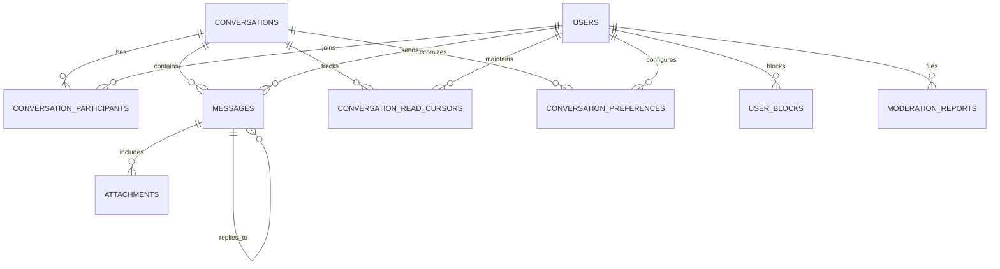

# PHASE 20A — REAL-TIME MESSAGING DATABASE SCHEMA SPECIFICATION

**Database:** PostgreSQL 16+ (with PostGIS, UUID-OSSP, PG_TRGM extensions)  
**ORM:** SQLAlchemy 2.0 (Asyncpg)  
**Migration Tool:** Alembic  

---

## 1. Entity-Relationship Overview

---

## 2. Table Specifications & Constraints

### 2.1 `conversations`
Authoritative record of a communication thread between two or more participants.

| Column | Type | Nullable | Default | Description |
| :--- | :--- | :--- | :--- | :--- |
| `id` | `UUID` | No | `uuid_generate_v4()` | Primary key |
| `type` | `VARCHAR(32)` | No | `'direct'` | `'direct'`, `'property_inquiry'`, `'flatmate_match'`, `'application_linked'`, `'group'`, `'owner_tenant'`, `'pg_enquiry'` |
| `title` | `VARCHAR(255)` | Yes | `NULL` | Optional title (mandatory for groups) |
| `property_id` | `UUID` | Yes | `NULL` | FK -> `properties.id` (ON DELETE SET NULL) |
| `application_id`| `UUID` | Yes | `NULL` | FK -> `applications.id` (ON DELETE SET NULL) |
| `group_id` | `UUID` | Yes | `NULL` | FK -> `groups.id` (ON DELETE SET NULL) |
| `flatmate_match_id`| `UUID`| Yes | `NULL` | FK -> `mutual_matches.id` (ON DELETE SET NULL) |
| `status` | `VARCHAR(32)` | No | `'active'` | `'active'`, `'archived'`, `'closed'`, `'disabled'` |
| `context_metadata` | `JSONB` | No | `'{}'` | Key-value contextual state (e.g. PG room number, listing status) |
| `created_at` | `TIMESTAMPTZ` | No | `NOW()` | Timestamp created |
| `last_message_at`| `TIMESTAMPTZ` | No | `NOW()` | Last message timestamp for inbox sorting |

**Indexes & Constraints:**
- Index on `(last_message_at DESC)`
- Index on `(property_id)`
- Index on `(application_id)`
- Index on `(group_id)`

---

### 2.2 `conversation_participants`
Tracks participant membership, permissions, and roles within a conversation.

| Column | Type | Nullable | Default | Description |
| :--- | :--- | :--- | :--- | :--- |
| `id` | `UUID` | No | `uuid_generate_v4()` | Primary key |
| `conversation_id` | `UUID` | No | - | FK -> `conversations.id` (ON DELETE CASCADE) |
| `user_id` | `UUID` | No | - | FK -> `users.id` (ON DELETE CASCADE) |
| `role` | `VARCHAR(32)` | No | `'member'` | `'admin'`, `'member'` |
| `joined_at` | `TIMESTAMPTZ` | No | `NOW()` | Timestamp joined |
| `left_at` | `TIMESTAMPTZ` | Yes | `NULL` | Timestamp removed / departed |
| `is_active` | `BOOLEAN` | No | `TRUE` | False when removed or left |

**Indexes & Constraints:**
- Unique constraint: `(conversation_id, user_id)`
- Index on `(user_id, is_active)`
- Index on `(conversation_id, is_active)`

---

### 2.3 `messages`
Durable plain-text or structured message entity.

| Column | Type | Nullable | Default | Description |
| :--- | :--- | :--- | :--- | :--- |
| `id` | `UUID` | No | `uuid_generate_v4()` | Primary key |
| `conversation_id` | `UUID` | No | - | FK -> `conversations.id` (ON DELETE CASCADE) |
| `sender_id` | `UUID` | No | - | FK -> `users.id` (ON DELETE CASCADE) |
| `content` | `TEXT` | No | - | Message body |
| `message_type` | `VARCHAR(32)` | No | `'text'` | `'text'`, `'image'`, `'file'`, `'property_card'`, `'system'` |
| `idempotency_key`| `VARCHAR(64)` | Yes | `NULL` | Client-generated key for duplicate prevention |
| `reply_to_message_id` | `UUID` | Yes | `NULL` | FK -> `messages.id` (ON DELETE SET NULL) |
| `is_edited` | `BOOLEAN` | No | `FALSE` | Edited flag |
| `edited_at` | `TIMESTAMPTZ` | Yes | `NULL` | Timestamp edited |
| `is_deleted` | `BOOLEAN` | No | `FALSE` | Soft-deleted flag |
| `deleted_at` | `TIMESTAMPTZ` | Yes | `NULL` | Timestamp deleted |
| `metadata` | `JSONB` | No | `'{}'` | Rich metadata, card data, or client state |
| `sent_at` | `TIMESTAMPTZ` | No | `NOW()` | Timestamp posted |

**Indexes & Constraints:**
- Unique constraint: `(conversation_id, idempotency_key)` WHERE idempotency_key IS NOT NULL
- Index on `(conversation_id, sent_at ASC)`
- Index on `(sender_id)`
- Index on `(reply_to_message_id)`

---

### 2.4 `attachments`
Attached media files and documents tied to conversations and messages.

| Column | Type | Nullable | Default | Description |
| :--- | :--- | :--- | :--- | :--- |
| `id` | `UUID` | No | `uuid_generate_v4()` | Primary key |
| `conversation_id` | `UUID` | No | - | FK -> `conversations.id` (ON DELETE CASCADE) |
| `message_id` | `UUID` | Yes | `NULL` | FK -> `messages.id` (ON DELETE CASCADE) |
| `uploader_id` | `UUID` | No | - | FK -> `users.id` (ON DELETE CASCADE) |
| `file_name` | `VARCHAR(255)` | No | - | Original sanitized file name |
| `file_path` | `VARCHAR(512)` | No | - | Storage path / key |
| `mime_type` | `VARCHAR(100)` | No | - | Validated MIME type (JPEG, PNG, WebP, PDF) |
| `file_size_bytes` | `BIGINT` | No | - | File size in bytes (max 10MB) |
| `created_at` | `TIMESTAMPTZ` | No | `NOW()` | Timestamp uploaded |

**Indexes & Constraints:**
- Index on `(conversation_id)`
- Index on `(message_id)`
- Index on `(uploader_id)`

---

### 2.5 `conversation_read_cursors`
Tracks per-user last read message in each conversation for instant unread calculation.

| Column | Type | Nullable | Default | Description |
| :--- | :--- | :--- | :--- | :--- |
| `id` | `UUID` | No | `uuid_generate_v4()` | Primary key |
| `conversation_id` | `UUID` | No | - | FK -> `conversations.id` (ON DELETE CASCADE) |
| `user_id` | `UUID` | No | - | FK -> `users.id` (ON DELETE CASCADE) |
| `last_read_message_id` | `UUID` | Yes | `NULL` | FK -> `messages.id` (ON DELETE SET NULL) |
| `last_read_at` | `TIMESTAMPTZ` | No | `NOW()` | Timestamp read cursor was updated |

**Indexes & Constraints:**
- Unique constraint: `(conversation_id, user_id)`
- Index on `(user_id, last_read_at)`

---

### 2.6 `conversation_preferences`
User-specific conversation overrides (mute, archive, custom notification settings).

| Column | Type | Nullable | Default | Description |
| :--- | :--- | :--- | :--- | :--- |
| `id` | `UUID` | No | `uuid_generate_v4()` | Primary key |
| `conversation_id` | `UUID` | No | - | FK -> `conversations.id` (ON DELETE CASCADE) |
| `user_id` | `UUID` | No | - | FK -> `users.id` (ON DELETE CASCADE) |
| `is_muted` | `BOOLEAN` | No | `FALSE` | Mute toggle |
| `muted_until` | `TIMESTAMPTZ` | Yes | `NULL` | Muted until datetime |
| `is_archived` | `BOOLEAN` | No | `FALSE` | Archive toggle |
| `created_at` | `TIMESTAMPTZ` | No | `NOW()` | Timestamp created |
| `updated_at` | `TIMESTAMPTZ` | No | `NOW()` | Timestamp updated |

**Indexes & Constraints:**
- Unique constraint: `(conversation_id, user_id)`
- Index on `(user_id, is_archived)`

---

### 2.7 `outbox_events`
Transactional outbox ensuring reliable event delivery to Redis Pub/Sub.

| Column | Type | Nullable | Default | Description |
| :--- | :--- | :--- | :--- | :--- |
| `id` | `UUID` | No | `uuid_generate_v4()` | Primary key |
| `event_type` | `VARCHAR(64)` | No | - | Event name |
| `payload` | `JSONB` | No | - | Full event payload |
| `status` | `VARCHAR(32)` | No | `'pending'` | `'pending'`, `'published'`, `'failed'` |
| `retry_count` | `INTEGER` | No | `0` | Number of publish retries |
| `created_at` | `TIMESTAMPTZ` | No | `NOW()` | Timestamp inserted |
| `processed_at` | `TIMESTAMPTZ` | Yes | `NULL` | Timestamp dispatched |

**Indexes & Constraints:**
- Index on `(status, created_at)`
