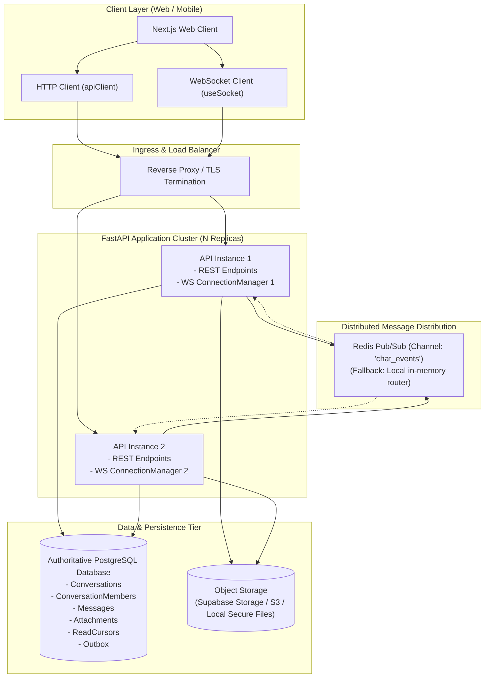

# PHASE 20A — REAL-TIME MESSAGING ARCHITECTURE SPECIFICATION

**System:** Flatmate Compatibility & Rental Marketplace  
**Architecture:** Next.js (TypeScript) + FastAPI (Python 3.13) + PostgreSQL + Supabase / Redis Pub/Sub  
**Document:** System Architecture & Distributed Component Model

---

## 1. Architectural Overview

The Phase 20A Real-Time Messaging and Communication System provides secure, persistent, scalable, and observable real-time messaging between marketplace actors (room seekers, flatmates, property owners, and flatmate groups).

---

## 2. Component Breakdown

### 2.1 Backend Services (`apps/api/app/modules/messaging/`)
1. **ConversationService / MessagingService:**
   - Enforces marketplace conversation rules (1-to-1, property-linked, application-linked, group, flatmate-match).
   - Validates uniqueness constraints so duplicate conversations for the same context are prevented.
   - Manages participant membership, roles (`admin`, `member`), muting, and archiving.
   - Enforces user block checks via `ModerationService`.
2. **MessagePersistenceEngine:**
   - Transactional commit of plain-text and structured content.
   - Idempotency key handling (`idempotency_key` unique per conversation to prevent duplicate retries).
   - Server-generated UUID and UTC timestamping.
   - Soft-deletion and editing audit metadata.
   - Attachment linking and validation.
3. **ReadCursorManager:**
   - Tracks per-user last-read message position (`read_cursors` table).
   - Efficient single-row update per user per conversation; avoids updating millions of historical rows.
   - Generates accurate unread counters for inboxes.
4. **WebSocket Connection Manager (`websocket.py`):**
   - Authenticated WebSocket endpoint (`/api/v1/messaging/ws`).
   - Validates JWT from query param or initial auth frame; extracts caller's `user_id`.
   - Manages multi-device / multi-tab connections per user ID.
   - Heartbeat management: client ping -> server pong with keep-alive timeout.
5. **Distributed Event Broker (`broker.py`):**
   - Broadcasts events to Redis channel `flatmate:chat:events`.
   - Each API worker subscribes to Redis pub/sub and relays incoming events to its locally attached WebSocket connections.
   - Graceful fallback: If Redis is unavailable, runs in standalone process-local broadcast mode with persistent PostgreSQL fallback.
6. **Outbox Worker (`outbox.py`):**
   - Transacts message event rows in an `outbox` table during the primary database commit.
   - Ensures at-least-once distributed event publication even if Redis temporarily glitches during commit.

---

## 3. Data Integrity & Delivery Guarantees

1. **Authoritative Store:** PostgreSQL is the single source of truth. No message is confirmed to a client as durable (`message.created` / HTTP 201) until the database transaction is successfully committed.
2. **Delivery Guarantee:**
   - Network delivery across distributed nodes is **at-least-once**.
   - Clients supply a client-generated UUID `idempotency_key`. If a network glitch causes the client to resend, the backend detects the duplicate key and returns the existing message without re-inserting or broadcasting duplicate notifications.
3. **Recovery on Reconnect:**
   - When a WebSocket reconnects, the client issues a REST fetch (`GET /api/v1/messaging/conversations/{id}/messages?since={last_known_message_id}`) or passes `last_event_id` to retrieve any messages or receipts sent while offline.

---

## 4. Security & Access Control Model

1. **Authentication:**
   - JWT tokens verified using HMAC-SHA256 (`decode_token`). Tokens contain subject user ID (`sub`).
   - Frontend-supplied sender IDs are **completely ignored**; sender ID is bound strictly to the verified JWT subject.
2. **Authorization (IDOR Prevention):**
   - Every read, write, attachment upload, receipt update, and typing event validates that the user is an active participant in `conversation_participants`.
   - If a participant has been removed from a group conversation, their access is revoked immediately.
3. **Safety & Blocking:**
   - If User A blocks User B, User B cannot send messages to User A or initiate a new conversation.
   - Existing conversation history remains visible according to retention policy, but new message creation is rejected with HTTP 403 Forbidden.
4. **Attachment Security:**
   - Attachments stored in private storage buckets.
   - Downloads require a time-limited signed URL generated only after validating that the requesting user is a member of the conversation.
