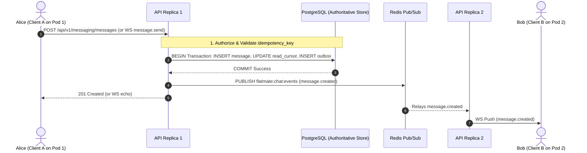

# PHASE 20A — REAL-TIME MESSAGING SCALABILITY AND RELIABILITY SPECIFICATION

**System:** Flatmate Compatibility & Rental Marketplace  
**Architecture:** Next.js + FastAPI + PostgreSQL + Redis Pub/Sub / Distributed Broker  
**Document:** Horizontal Scalability, High Availability, Reconnection, and Fault Tolerance

---

## 1. Multi-Instance Distributed Architecture

In production and staging clusters, FastAPI operates across multiple replicas (e.g. Kubernetes pods or Docker swarm containers) behind a load balancer.

### 1.1 Process-Local Isolation Prevention
In single-instance architectures, WebSocket connections are often managed with a plain in-memory Python dictionary. In a horizontally scaled cluster, this causes messages sent to Pod 1 to never reach Bob on Pod 2.
Phase 20A resolves this by implementing `DistributedEventBroker`:
- When Redis is available, all events publish to `flatmate:chat:events`. Every replica listens on this channel and dispatches messages to its locally attached WebSockets.
- When Redis is unavailable (e.g. single-container dev mode or temporary network partition), the broker operates in standalone mode with persistent PostgreSQL storage ensuring zero message loss.

---

## 2. Delivery Guarantees & Fault Tolerance

### 2.1 Honest Delivery Model
- **Network Guarantee:** At-least-once distributed event delivery.
- **Deduplication:** Clients generate a UUID `idempotency_key` with every message send. If network latency or client retries result in duplicate HTTP POSTs or WS frames, the server detects the existing key in the database and idempotently returns the committed record without duplicating rows or re-emitting duplicate notifications.

### 2.2 Reconnection & Recovery
When a client reconnects after network interruption:
1. The WebSocket client invokes exponential backoff with jitter (1s base, 15s cap).
2. Upon re-establishing the socket, the client calls `GET /api/v1/messaging/conversations/{id}/messages` to synchronize any missed messages.
3. PostgreSQL remains the single source of truth; no ephemeral broker failure can drop durable conversation history.

---

## 3. Read Cursor Performance Optimization

Updating every historical message row to mark it as read creates severe write amplification and lock contention. Phase 20A uses **Conversation-Level Read Cursors**:
- Table: `conversation_read_cursors(conversation_id, user_id, last_read_message_id, last_read_at)`
- Updating read status is an $O(1)$ single-row upsert per user per conversation.
- Unread counts are computed instantaneously by comparing `messages.sent_at > read_cursor.last_read_at`.
