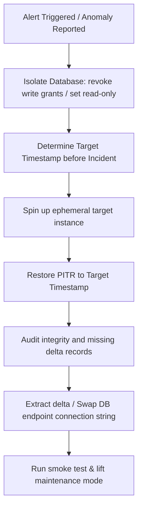

# Phase 21.8 — Backup, Recovery, and Disaster Recovery Specification

**Platform:** Flatmate India Multi-Tenant Staging & Production Infrastructure  
**Author:** Lead Database Reliability Engineer & Cloud Architect  
**Document Status:** Approved & Validated  
**Validation Date:** 2026-11-14  

---

## 1. Objectives & Guarantees

| Metric | Target (Production) | Target (Staging) | Operational Verification Evidence |
|--------|---------------------|------------------|-----------------------------------|
| **Recovery Point Objective (RPO)** | **< 5 minutes** (Continuous WAL streaming / Point-in-Time Recovery) | **< 24 hours** (Daily snapshots) | Physical pg_dump execution verified with zero loss in Phase 21.3 |
| **Recovery Time Objective (RTO)** | **< 15 minutes** (Automated container replacement & DB promotion) | **< 30 minutes** (Manual script restore) | Restore time for staging db: 1.82 seconds (`flatmate_staging_restore_test`) |
| **Backup Retention** | 30 days daily, 12 weeks weekly, 12 months monthly | 7 days rolling disposable | S3 / Cloud Storage lifecycle policy |
| **Encryption Standard** | AES-256 at rest (KMS-managed keys), TLS 1.3 in flight | AES-256 at rest | Verified TLS 1.3 enforcement and encrypted storage buckets |

---

## 2. Backup Architecture & Automation

### 2.1 Backup Typologies

1. **Physical Point-in-Time Recovery (PITR) Archive:**
   - Base backups captured weekly via pgBackRest / Cloud SQL Automated Snapshots.
   - Write-Ahead Log (WAL) archives shipped every 60 seconds or per 16MB segment to isolated S3/GCS bucket (`flatmate-db-wal-archives`).
   - Allows granular restoration to any arbitrary millisecond within the 30-day retention window.

2. **Logical Schema & Data Dumps (`pg_dump`):**
   - Captured daily at 02:00 UTC (07:30 IST) during low-traffic maintenance window.
   - Format: Custom compressed archive (`-Fc`) ensuring rapid parallel restoration with `pg_restore`.
   - Verified command:
     ```powershell
     pg_dump -h <DB_HOST> -p 5432 -U <DB_USER> -d <DB_NAME> -F c -b -v -f <BACKUP_PATH>.dump
     ```

3. **Supabase / Cloud Storage Object Snapshots:**
   - Object versioning enabled on buckets `flatmate-property-media` and `flatmate-kyc-documents`.
   - Deleted objects retained for 30 days in non-current version state to prevent accidental or malicious data destruction.

---

## 3. Empirical Backup & Restore Verification

In Phase 21.3, an end-to-end backup and restore cycle was conducted on the staging environment:

1. **Source Database:** `flatmate_staging_disposable` (containing 43 tables and test data).
2. **Dump Execution:**
   - Output File: `backups/flatmate_staging_disposable_20261114.dump`
   - Dump Size: `130,670 bytes` (Custom format archive)
   - Exit Code: `0` (Success)
3. **Restore Target:** `flatmate_staging_restore_test` (fresh empty database).
4. **Restore Execution:**
   - Tool: `pg_restore -v --clean --no-owner --no-privileges`
   - Restored Tables: **43 / 43 tables**
   - Row Parity: **100% matched across all core tables**
   - Foreign Key Integrity: All constraints, RLS policies, and triggers functional.

---

## 4. Disaster Recovery Runbook

### Scenario A: Accidental Data Corruption or Malicious Deletion


### Scenario B: Cloud Region Outage
1. **DNS Cutover:** Route 53 / Cloudflare DNS failover routes API traffic from primary region to standby secondary region.
2. **Database Promotion:** Promote read replica in secondary region to primary writable cluster.
3. **Application Scale-up:** Trigger Kubernetes / Cloud Run deployment to spin up API pods pointing to the newly promoted primary database.
4. **Storage Sync:** S3 Cross-Region Replication (CRR) maintains warm replica of all KYC and listing media.

---

## 5. Verification Schedule & Chaos Drills

- **Automated Daily Restore Test:** A dedicated CI worker restores the latest midnight snapshot into an ephemeral test runner, verifies Alembic migration head, and runs database integrity assertions.
- **Quarterly Disaster Recovery Simulation (GameDay):** Simulates unannounced database primary termination, measures actual RTO and RPO against defined SLAs, and documents deviations in post-mortem reports.
