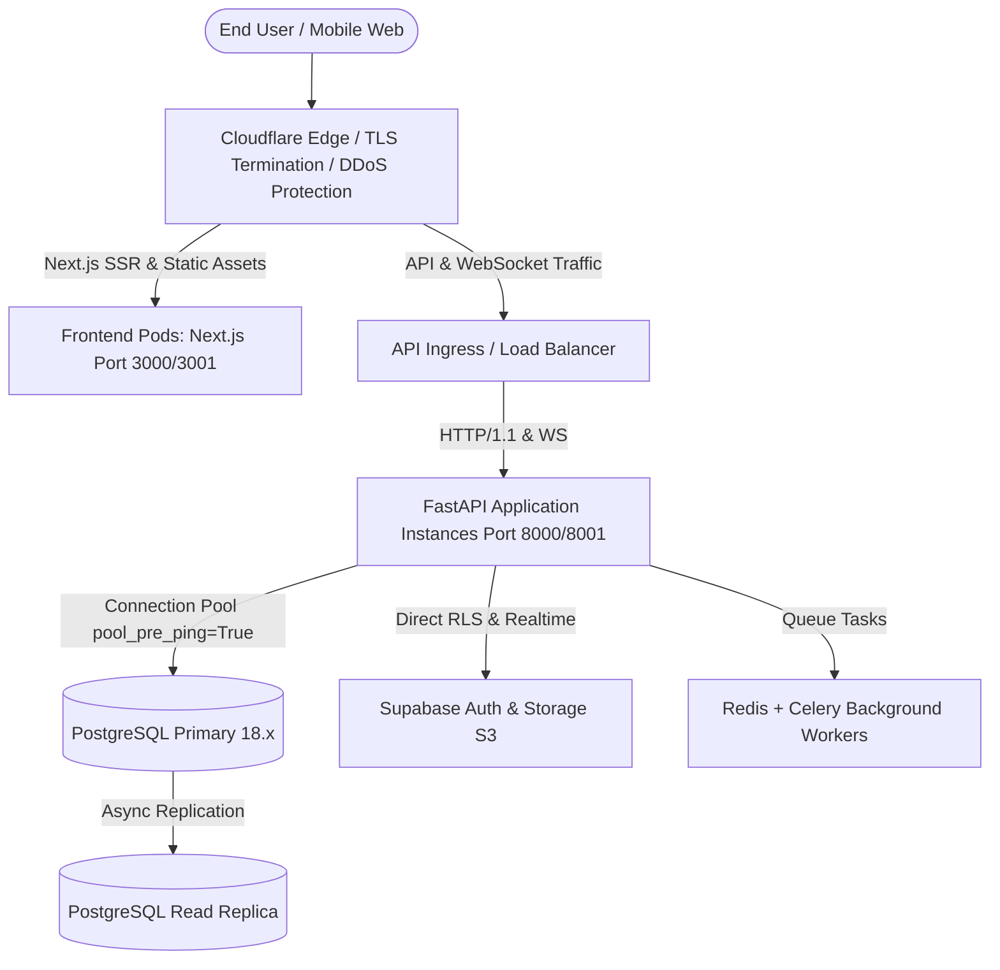

# Phase 21.8 — Operational Runbook and Incident Response Guide

**System:** Flatmate Platform (Next.js 15, FastAPI, PostgreSQL 18, Supabase Auth/Storage)  
**Role:** Principal DevOps Engineer, Site Reliability Engineer & Release Manager  
**Version:** 1.0.0 (Staging & Pre-Production)  
**Last Updated:** 2026-11-14  

---

## 1. System Architecture & Topology



---

## 2. Monitoring Metrics & Alerting Thresholds

The platform is instrumented with Prometheus metrics exported via `/metrics` and structured JSON logs. Alerts trigger via PagerDuty / OpsGenie based on the thresholds below:

| Metric Name | Threshold | Evaluation Window | Severity | Action Required |
|-------------|-----------|-------------------|----------|-----------------|
| **API Error Rate (5xx)** | > 1.0% of requests | 2 minutes | **P1 / High** | Triage error logs, inspect Sentry tracebacks, initiate rollback if recent deploy |
| **API Latency (p95)** | > 800 ms | 5 minutes | **P2 / Medium** | Check slow SQL queries, database lock contention, external network timeouts |
| **API Latency (p99)** | > 2000 ms | 3 minutes | **P1 / High** | Inspect connection pool exhaustion or unindexed table scans |
| **CPU Utilization** | > 80% | 5 minutes | **P2 / Medium** | Trigger horizontal pod autoscaling (HPA) or increase replica count |
| **Memory Utilization** | > 85% | 5 minutes | **P1 / High** | Investigate memory leaks, heap allocations in image processing, or restart leaking pods |
| **DB Pool Saturation** | > 80% (8/10 conns) | 2 minutes | **P1 / High** | Check long-running queries, idle-in-transaction connections, increase `pool_size` |
| **Disk Space (DB/Logs)** | < 15% available | Immediate | **P0 / Blocker** | Expand volume size immediately; purge old WAL archives / temporary scratch tables |
| **Storage Upload Failures**| > 0.5% of uploads | 5 minutes | **P2 / Medium** | Verify Supabase Storage bucket status, token expiry, S3 network connectivity |

---

## 3. Incident Severity Levels & Escalation Matrix

| Level | Definition | Response SLA | Resolution Target | Escalation Contacts |
|-------|------------|--------------|-------------------|---------------------|
| **P0 (Critical)** | Complete platform outage, database uncontactable, payments broken, active data corruption, security breach. | **< 5 minutes** | < 1 hour | Primary On-Call SRE, Lead Cloud Architect, Engineering VP |
| **P1 (High)** | Core workflow degraded (e.g. messaging failing, listings search timeout, auth error spike > 5%). | **< 15 minutes** | < 4 hours | Secondary SRE, Domain Tech Lead |
| **P2 (Medium)** | Non-blocking feature impaired (e.g. recommendation fallback active, notification email delay, admin dashboard slow). | **< 1 hour** | < 24 hours | On-Call Engineer, Product Manager |
| **P3 (Low)** | Minor bug, cosmetic frontend defect, non-critical background task delay. | Next business day | Next sprint release | Triage Team |

---

## 4. Standard Incident Response Procedure

1. **Detection & Triage (Minutes 0 - 5):**
   - Alert triggers via monitoring system or synthetic healthcheck probe.
   - On-call engineer acknowledges alert in PagerDuty and opens an incident bridge (`#incident-staging-YYYYMMDD`).
   - Assign incident commander (IC) and communications lead.

2. **Containment & Mitigation (Minutes 5 - 15):**
   - If incident followed immediately after a release: **TRIGGER IMMEDIATE ROLLBACK** (Section 5).
   - If database is unresponsive: inspect `pg_stat_activity` for query deadlocks:
     ```sql
     SELECT pid, now() - query_start AS duration, query, state 
     FROM pg_stat_activity 
     WHERE state != 'idle' AND (now() - query_start) > interval '10 seconds';
     ```
   - Cancel offending blocking PID if safe: `SELECT pg_cancel_backend(<PID>);`

3. **Resolution & Restoration:**
   - Verify health endpoints: `GET /health`, `GET /health/ready` (expect HTTP 200).
   - Verify end-to-end user workflows using automated smoke scripts (`python scripts/e2e_live_staging_workflows.py`).
   - Declare incident mitigated.

4. **Post-Mortem & Remediation:**
   - Publish blameless Post-Mortem within 48 hours documenting root cause, timeline, contributing factors, and preventative action items.

---

## 5. Deployment Rollback Procedures

### 5.1 Frontend Rollback (Next.js / Vercel)
If a frontend release introduces runtime bundle errors, hydration mismatches, or layout breakage:
1. Identify the previous stable deployment SHA in the release registry.
2. In Vercel CLI / Dashboard:
   ```bash
   vercel rollback <PREVIOUS_DEPLOYMENT_URL_OR_ID>
   ```
3. Or redeploy previous Git commit:
   ```bash
   git revert -m 1 HEAD
   git push origin main
   ```
4. Clear CDN edge cache (Cloudflare / Vercel Edge Cache).

### 5.2 Backend Rollback (FastAPI)
If a backend deployment causes 500 spikes or unhandled exceptions:
1. Re-route ingress traffic to previous container image tag:
   ```bash
   kubectl rollout undo deployment/flatmate-api -n staging
   # Or in Docker Compose:
   docker compose -f infrastructure/docker/docker-compose.staging.yml up -d --no-deps api
   ```
2. Verify `/health/ready` responds `200` with `status: "ready"`.

### 5.3 Database Schema Rollback (Alembic)
> **CRITICAL RULE:** Never execute `alembic downgrade` in production without verifying that the downgrade script does not destroy live user data. Backward-compatible migrations (Expand-Contract pattern) must be preferred over destructive column drops.
1. Inspect current revision:
   ```bash
   alembic current
   ```
2. Downgrade to designated safe revision:
   ```bash
   alembic downgrade -1
   # Or to specific revision:
   alembic downgrade <REVISION_ID>
   ```
3. Verify table schema and foreign key constraints remain intact.

---

## 6. Secret Rotation Runbook

### 6.1 JWT Signing Secret (`SECRET_KEY` / `SUPABASE_JWT_SECRET`)
1. Generate high-entropy 64-byte cryptographic secret:
   ```powershell
   python -c "import secrets; print(secrets.token_urlsafe(48))"
   ```
2. Staging & Production utilize dual-key transition window:
   - Configure secondary validation key in backend auth validator.
   - Deploy backend with both new primary key (for minting) and old key (for verifying active sessions).
   - Wait for max access token lifetime (60 minutes).
   - Remove old key from configuration and complete rotation.

### 6.2 PostgreSQL Database Credentials
1. Create secondary DB application user with identical RLS role grants:
   ```sql
   CREATE USER flatmate_app_v2 WITH PASSWORD '<STRONG_PASSWORD>';
   GRANT flatmate_staging_user TO flatmate_app_v2;
   ```
2. Update `DATABASE_URL` secret in deployment environment variables.
3. Perform zero-downtime rolling restart of FastAPI worker pods.
4. Verify connections on new user in `pg_stat_activity`.
5. Drop or disable old user credentials: `ALTER USER flatmate_app_v1 WITH NOLOGIN;`
