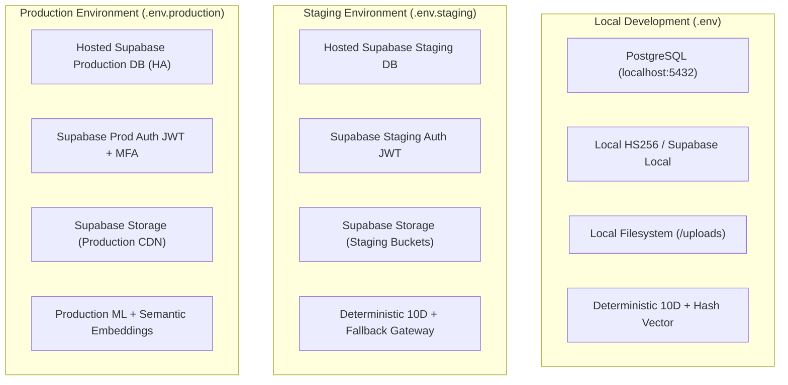

# PHASE 22.2 — Secure Real Credential & Environment Configuration

**Document Version:** 1.0  
**Phase:** 22.2 — Secure Credential & Environment Management  
**Date:** November 14, 2026  
**Auditor Roles:** Principal Application Security Engineer, Cloud Architect, DevOps Engineer  
**Classification:** Operational Security Standard  

---

## 1. Executive Summary

This document specifies the unified, non-conflicting environment variable hierarchy and security standards for connecting the Flatmate Compatibility & Rental Marketplace to a real Supabase project and hosted cloud infrastructure.

In strict compliance with Phase 22 security directives:
- **Zero Secrets in Code or Repositories:** No actual passwords, private service-role keys, or JWT secrets are stored in Git history, markdown documentation, or test scripts.
- **Client Bundle Isolation:** `NEXT_PUBLIC_*` variables are strictly restricted to public parameters (Supabase URL, Anon Key, API URL, WS URL). All administrative keys (`SUPABASE_SERVICE_ROLE_KEY`, `DATABASE_URL`, `SECRET_KEY`) are rejected from client-side compilation.
- **Zero-Leak Validation Protocol:** The validation tool (`scripts/validate_environment_config.py`) inspects syntax, entropy, and URL schemes without printing or logging secret values.

---

## 2. Environment Variable Master Specification

### 2.1 Frontend Configuration (Browser Safe)
Loaded in `apps/web/.env.local` or Next.js deployment environment:

| Variable Name | Required? | Format / Example | Security Classification | Purpose |
| :--- | :--- | :--- | :--- | :--- |
| `NEXT_PUBLIC_APP_URL` | Yes | `https://staging.flatmate.platform` | Public | Canonical web client base URL |
| `NEXT_PUBLIC_API_URL` | Yes | `https://api-staging.flatmate.platform/api/v1` | Public | Centralized REST API base endpoint |
| `NEXT_PUBLIC_WS_URL` | Yes | `wss://api-staging.flatmate.platform/api/v1/messaging/ws`| Public | Real-time WebSocket connection endpoint |
| `NEXT_PUBLIC_SUPABASE_URL` | Yes | `https://<project-ref>.supabase.co` | Public | Hosted Supabase project URL |
| `NEXT_PUBLIC_SUPABASE_ANON_KEY` | Yes | `eyJhbGciOiJIUzI1NiIsInR5cCI6IkpXVCJ9...` | Public (Client RLS Bound) | Supabase anonymous public key |

### 2.2 Backend Configuration (Server-Side Only)
Loaded in `apps/api/.env` or server container environment:

| Variable Name | Required? | Format / Specification | Security Classification | Purpose |
| :--- | :--- | :--- | :--- | :--- |
| `ENVIRONMENT` | Yes | `development` \| `staging` \| `production` | Operational | Runtime security profile & fallback behavior |
| `SECRET_KEY` | Yes | Cryptographic token (min 32 chars) | **HIGH SECRET** | Internal cryptographic operations & fallback signing |
| `DATABASE_URL` | Yes | `postgresql+asyncpg://<user>:<pw>@<host>:5432/<db>?ssl=require` | **CRITICAL SECRET** | Async SQLAlchemy primary connection string |
| `DATABASE_SYNC_URL` | Yes | `postgresql://<user>:<pw>@<host>:5432/<db>?ssl=require` | **CRITICAL SECRET** | Sync connection string for Alembic migrations |
| `SUPABASE_URL` | Yes | `https://<project-ref>.supabase.co` | Internal Config | Supabase API URL for Auth & Storage |
| `SUPABASE_ANON_KEY` | Yes | Valid 3-part JWT string | Internal Config | Supabase anonymous key for public queries |
| `SUPABASE_SERVICE_ROLE_KEY` | Yes (for Storage admin) | Valid 3-part JWT string | **CRITICAL SECRET** | Supabase service-role administrative key |
| `SUPABASE_JWT_SECRET` | Yes | String (min 32 chars) | **CRITICAL SECRET** | Supabase Auth JWT signature verification key |
| `STORAGE_TYPE` | Yes | `supabase` \| `local` \| `s3` | Operational | Active object storage driver |
| `SUPABASE_STORAGE_BUCKET`| Yes | `flatmate-media-staging` | Operational | Default media bucket name |
| `PROPERTY_PHOTOS_BUCKET` | Yes | `staging-property-photos` | Operational | Public property photos bucket |
| `VERIFICATION_DOCS_BUCKET`| Yes | `staging-verification-docs` | Operational | Private verification proofs bucket |
| `CORS_ORIGINS` | Yes | JSON array or comma-separated URLs | Security Boundary | Allowed cross-origin browser origins |

### 2.3 Optional AI/ML Subsystem Configuration
Loaded when external inference providers are provisioned:

| Variable Name | Required? | Format / Default | Security Classification | Purpose |
| :--- | :--- | :--- | :--- | :--- |
| `VECTOR_EMBEDDING_DIM` | No | `64` (default) \| `1536` | Operational | Embedding vector dimensionality |
| `ML_RECOMMENDATION_ENDPOINT`| Optional | HTTPS URL | Internal Config | External reranking inference service |
| `ML_RECOMMENDATION_API_KEY` | Optional | Bearer Token / API Key | **SECRET** | External reranker authorization key |
| `AI_MODERATION_ENDPOINT` | Optional | HTTPS URL | Internal Config | External LLM moderation API |
| `AI_MODERATION_API_KEY` | Optional | Bearer Token / API Key | **SECRET** | External moderation API key |
| `AI_INFERENCE_TIMEOUT_MS` | Optional | `3000` (default: 3 seconds) | Operational | Gateway timeout before deterministic fallback |

---

## 3. Environment Segregation Matrix



---

## 4. Zero-Leak Verification Procedure

The project includes an automated configuration auditor `scripts/validate_environment_config.py` that checks the format and presence of all variables without revealing their contents:

```bash
# Verify local development or staging configuration
python scripts/validate_environment_config.py .env.staging
```

### Safety Rules for Operators:
1. **Never commit `.env`, `.env.staging`, or `.env.production` files.** All `.env*` files (except explicit `.example` files) are blocked by `.gitignore`.
2. **Never print secrets in CI/CD logs or terminal output.**
3. **Use secure shell input (`read -s`) when setting credentials in terminal.**
4. If real external credentials are not yet supplied by the project owner, mark the external integration as **`BLOCKED (NEEDS CREDENTIALS)`** and maintain local verification evidence.
