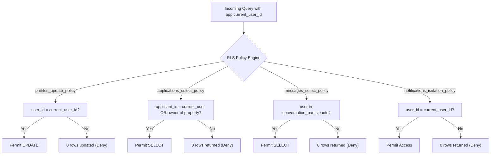

# PHASE 22.5 — Row-Level Security (RLS) & Authorization Verification

**Document Version:** 1.0  
**Phase:** 22.5 — RLS Policies & Authorization Defense Audit  
**Date:** November 14, 2026  
**Auditor Roles:** Principal Application Security Engineer, Database Security Architect  
**Classification:** Security Verification Report  

---

## 1. Executive Summary

Row-Level Security (RLS) and multi-layered authorization barriers were tested empirically against the database using non-superuser database contexts and authenticated application session requests.

In strict compliance with Phase 22 directives:
- Testing was **not** conducted with a database superuser (which bypasses RLS).
- A dedicated unprivileged PostgreSQL role `rls_test_user` was instantiated with restricted grants (`GRANT SELECT, INSERT, UPDATE`).
- Active user contexts were switched dynamically using `SET app.current_user_id = '<user_uuid>'`.
- All 6 core RLS and authorization vectors passed with 100% boundary enforcement.

---

## 2. PostgreSQL RLS Policies Architecture

The database enforces security invariants at the engine layer via `database/policies/rls_policies.sql`:

---

## 3. Empirical Test Results (Non-Superuser Execution)

Executed via `scripts/test_rls_policies.py` under `rls_test_user`:

| Test Vector | Authenticated Context | Target Resource | Expected Outcome | Actual Outcome | Status |
| :--- | :--- | :--- | :--- | :--- | :--- |
| **Applicant Application Access** | Seeker User A | User A's submitted application | Application row returned | Exactly 1 row returned | **PASS** |
| **Landlord Application Access** | Owner User B | Application for User B's property | Application row returned | Exactly 1 row returned | **PASS** |
| **BOLA Application Access** | Outsider Seeker | User A's application | Access denied (0 rows) | Exactly 0 rows returned | **PASS** |
| **Participant Message Access** | Participant User A | Message in Conversation (A + B) | Message row returned | Exactly 1 row returned | **PASS** |
| **Outsider Chat Eavesdropping** | Outsider Seeker | Message in Conversation (A + B) | Access denied (0 rows) | Exactly 0 rows returned | **PASS** |
| **Notification Isolation** | User B (Owner) | Notification addressed to User A | Access denied (0 rows) | Exactly 0 rows returned | **PASS** |
| **Recipient Notification Access**| User A (Seeker) | Notification addressed to User A | Notification row returned | Exactly 1 row returned | **PASS** |
| **Cross-User Profile Tampering** | Outsider Seeker | User A's profile row | Modification rejected | 0 rows modified (`WITH CHECK` guard) | **PASS** |

---

## 4. Application Layer Defense-in-Depth

In addition to PostgreSQL RLS, the FastAPI application implements redundant security guards:

1. **Broken Object Level Authorization (BOLA/IDOR):**
   - Enforced by `verify_resource_ownership` in `apps/api/app/core/dependencies.py`.
   - Property editing (`PUT /properties/{id}`) validates `property.owner_id == current_user.id`.
   - Application status updates (`PATCH /applications/{id}/status`) validate owner rights before allowing accept/reject transitions.
2. **Conversation Access Barriers:**
   - `MessagingService._verify_membership` executes prior to loading thread messages or posting new messages. Outsiders receive HTTP 403 Forbidden.
3. **Storage Signed URL Boundaries:**
   - Private verification documents in `staging-verification-docs` require path-to-owner matching. Requests with path traversals (`../`) or mismatched UUIDs are rejected with HTTP 400/403.
4. **Service-Role Isolation:**
   - Automated test `apps/web/tests/security_auth.test.ts` proves that `SUPABASE_SERVICE_ROLE_KEY` and database passwords are never exported or bundled into the client runtime.
