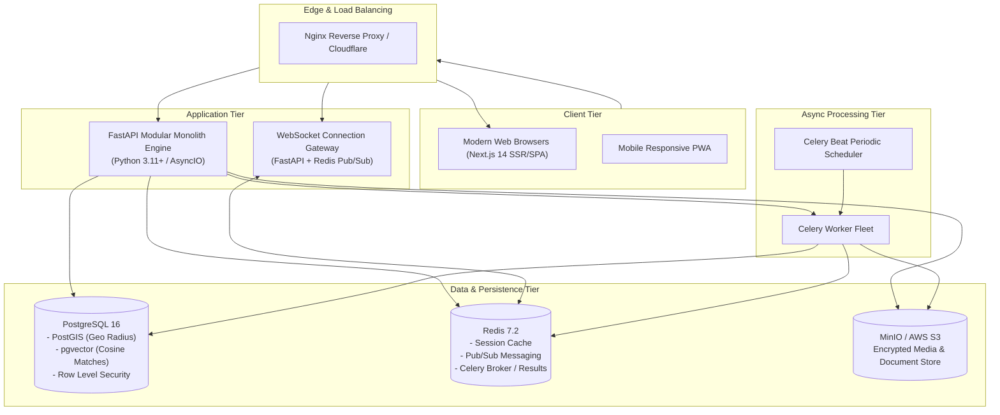
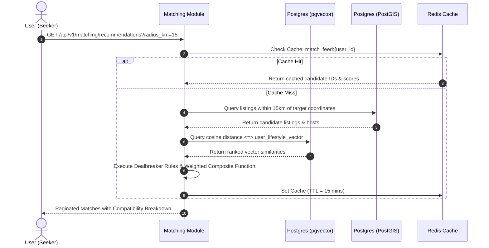
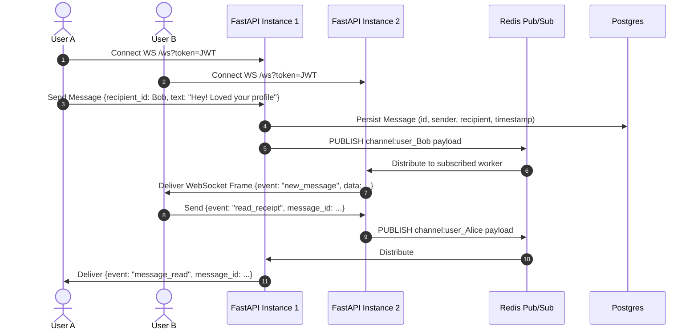

# System Architecture & Design Specification

**Document Version:** 1.0.0  
**Target Architecture:** Modular Monolith with Asynchronous Distributed Workers  

---

## 1. Architectural Philosophy

The **Flatmate Platform** utilizes a **Modular Monolith** architecture for the API backend paired with a **Server-Side Rendered (SSR) / Static Next.js 14 Frontend**.

### Why Modular Monolith?
- **High Cohesion, Low Coupling**: Modules (Auth, Profiles, Properties, Matching, Messaging) maintain strictly defined domain boundaries and communicate via explicit internal interfaces.
- **Operational Simplicity**: Avoids premature microservice distributed transaction overhead and networking latency.
- **Future-Proof**: Each module can be broken out into an independent microservice when scaling requirements dictate.

---

## 2. High-Level System Architecture

---

## 3. Core Component Breakdown

### 3.1 Backend Application Core (`apps/api`)
Built with **FastAPI** leveraging `asyncio` for non-blocking I/O operations.
- **Core Layer**: Central configuration, async database session pooling (`asyncpg`), JWT authentication, exception handling, custom response envelopes.
- **Domain Modules**:
  1. `auth`: JWT issuance, OAuth2 token validation, password hashing via `passlib[bcrypt]`.
  2. `users`: User entity state, RBAC (Seeker, Owner, Admin).
  3. `profiles`: Questionnaire data, preferences, lifestyle attributes.
  4. `properties`: Listings, spatial geometries, room specifications, amenities.
  5. `matching`: Composite scoring algorithm & vector cosine similarity.
  6. `groups`: Hunting syndicates, collective wishlists, group voting.
  7. `applications`: Tenancy workflow state machine (Submitted -> Under Review -> Accepted / Declined).
  8. `owners`: Landlord dashboard, applicant screening, tenancy approval.
  9. `messaging`: Real-time conversation threads, read markers, attachments.
  10. `notifications`: Email, SMS, in-app notification dispatch.
  11. `verification`: Document upload, verification workflow, trust score aggregation.
  12. `moderation`: Report auditing, spam suppression, administrative control.

### 3.2 Matching & Search Engine Pipeline

The system employs a dual-tiered architecture:
1. **10-Dimensional Compatibility Engine (`v1.0-india-heuristic`)**:
   - Normalized multi-attribute scoring function where weights sum to exactly 1.000000.
   - 10 evaluated dimensions: Budget, Location/Commute, Cleanliness, Sleep Schedule, Food/Dietary Preferences, Smoking/Drinking, Social Battery, Work Habits, Guest Policy, and Pet Compatibility.
   - **Dealbreaker Ceiling**: If any critical lifestyle or budget dealbreaker is violated, the composite compatibility score is strictly capped at 30.0%.
2. **Deterministic 64-Dimensional Token Projection Search**:
   - Deterministic lexical hash-trick projection mapping Indian locality names, amenities, and user search terms into 64-dimensional sparse vectors for fast cosine distance ranking, with graceful fallback to PostGIS bounding-box filtering (`ST_DWithin`).

### 3.3 Real-Time WebSocket Architecture

---

## 4. Data Storage Architecture

### 4.1 Relational Database (`PostgreSQL 15+ / 16 / 18`)
- **Schema & Migrations**: 43 managed tables including `alembic_version` metadata tracking migration revision `002_messaging_realtime`.
- **Spatial Features (`PostGIS`)**:
  - `ST_DWithin` used for fast spatial bounding box and circular radius searches for listings and commute zones.
  - Spatial indexes (`GIST`) on `geometry(Point, 4326)`.
- **Vector & Projection Search**:
  - 64-dimensional lifestyle preference projections and token hashing for localized search.
  - Compatible with `pgvector` HNSW indexes and deterministic fallback scoring.
- **Connection Architecture**:
  - Direct connection on port 5432 or IPv4 Session/Transaction Pooler (`aws-0-ap-south-1.pooler.supabase.com:5432/6543`) on Supabase.
  - Fail-safe isolation: Backend strictly errors on missing database connections without silent fallback.

### 4.2 Cache & In-Memory State (`Redis 7.2`)
- **Key-Value Cache**: Profile summaries, frequently queried property listings, location geocoding lookup tables.
- **Ephemeral State**: Online presence tracking (`user:{id}:online`), typing indicators (3-second TTL keys).
- **Pub/Sub Channels**: Scalable inter-process event distribution for WebSocket cluster nodes.
- **Local Fallback**: Process-local in-memory pub/sub broker for development and single-instance deployments.

### 4.3 Object Storage (`Supabase Storage / MinIO / S3`)
- **Public Buckets**:
  - `property-photos`, `properties`, `avatars`: Profile pictures, listing gallery images, public property media.
- **Private Encrypted Buckets**:
  - `verification-docs`, `verification`, `chat-attachments`: Identity documents, Aadhaar/PAN avoidance checks, student IDs, encrypted chat attachments accessible only via short-lived signed URLs with strict ownership verification.

### 4.4 Authentication & Identity Tier (`Supabase Auth & JWKS`)
- Asymmetric `ES256` / `RS256` token verification against live hosted JWKS endpoint (`auth/v1/.well-known/jwks.json`) with 1-hour in-memory key caching.
- Symmetric `HS256` fallback for development environments and automated test mock tokens.
- Strict role-based access control (Seeker, Owner, Existing Tenant, PG Operator, Admin) enforced on the backend independent of frontend state.

---

## 5. Scalability & Resilience

1. **Horizontal Scaling**:
   - FastAPI backend instances are stateless and run behind load balancers with sticky sessions disabled.
   - Database read replicas for search queries; master instance for write transactions.
2. **Rate Limiting**:
   - Token bucket algorithm implemented via Redis middleware protecting auth and messaging endpoints.
3. **Graceful Degradation**:
   - In case of vector index maintenance, matching falls back to heuristic category weights without breaking the API contract.
