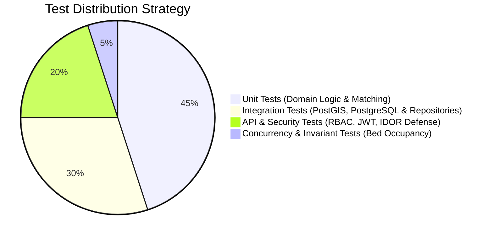

# Quality Assurance & Testing Protocol

**Document Version:** 1.0  
**Testing Framework:** `pytest`, `pytest-asyncio`, `respx`, `httpx`  

---

## 1. Testing Pyramid & Categories



### 1.1 Unit Tests
- Algorithmic compatibility calculations (cosine vector similarity, budget overlap, habit matching).
- Dealbreaker filters and non-negotiable evaluations.
- Pydantic v2 serialization, data validation, and custom validators.

### 1.2 Integration Tests
- PostgreSQL migrations upgrade/downgrade verification.
- PostGIS spatial radius queries with real geographic coordinates (Bengaluru, Mumbai, Delhi-NCR, Hyderabad, Pune).
- Transactional consistency during mutual matches and application updates.

### 1.3 Concurrency & Invariant Tests
- Bed-level and room-level PG occupancy protection against race conditions (`SELECT ... FOR UPDATE`).
- Prevention of simultaneous double-booking of private rooms.
- Duplicate application prevention on active listings.

### 1.4 Security & Authorization Tests
- Insecure Direct Object References (IDOR): ensuring tenant A cannot alter tenant B's application or view unshared messages.
- Signature verification of Supabase-issued JWTs.
- Token expiration enforcement and role privilege boundary tests.

---

## 2. Test Execution Commands

```bash
# Run complete test suite
pytest apps/api/tests -v

# Run with test coverage report
pytest apps/api/tests --cov=app --cov-report=term-missing

# Run security & authorization specific tests
pytest apps/api/tests -k "auth or security or rbac" -v

# Run matching engine tests
pytest apps/api/tests -k "matching or compatibility" -v
```
